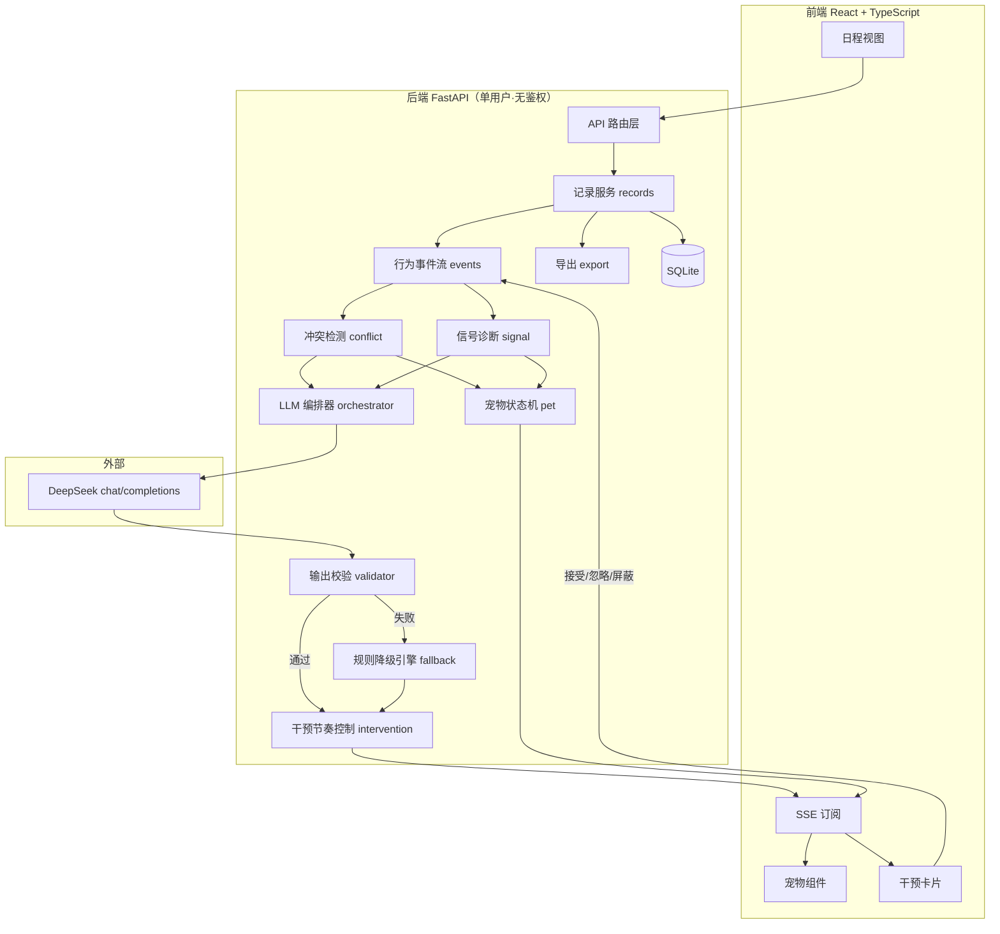
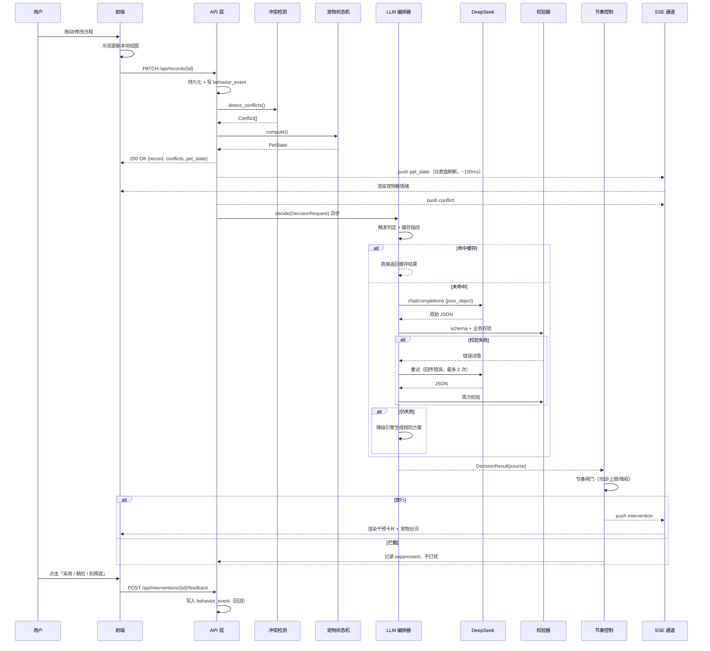

# 每日规划助手 · Web 全栈版架构设计

> **状态：已通过评审（含 4 条修正）** —— 待决项见 §9，A 组三项补齐后开工。
> **日期**：2026-10-28
> **LLM Provider**：DeepSeek（已选定）
> **上游项目**：Python 3.12 + Tkinter 桌面版（JSON 存储 / 深色模式 / 冲突检测 / CSV 导出 / 猫咪宠物）
> **版本**：本文描述 v1.0 最小闭环

---

## 0. 范围与定位

产品定位是 **AI 执行教练 / 拖延干预系统**，不是一个待办清单。

- 日程只是数据源之一；后续可扩展笔记、待办。因此数据模型从 `schedule` 抽象为统一的 `record`。
- 核心价值不在"记录"，而在 **分析执行数据 → 检测冲突 → 给出重排建议 → 主动干预 → 用宠物状态反馈执行力**。
- 大模型在系统中的角色是**决策器**，不是聊天窗口。

### 0.1 v1.0 范围（最小闭环）

**v1.0 只做一件事：跑通完整的干预闭环。** 任何不服务于这条闭环的功能一律后移。

| 包含 | 说明 |
|---|---|
| 记录 CRUD | v1.0 仅 `type=schedule` |
| 行为事件流 | 全量事件类型 |
| 冲突检测 | 确定性算法 |
| 信号诊断 | 拖延指数 v1 公式 |
| 宠物状态机 | 六档 + 优先级判定 |
| LLM 决策 | **仅** `reschedule` / `nudge` / `no_action` |
| 干预卡片与反馈回流 | 含 mute 降权 |
| DEMO_MODE 录制回放 | 提前到第一批实现 |
| CSV 导出 | 沿用旧版字段 |
| 旧版数据迁移 | `scripts/import_legacy.py` + `scripts/seed.py` |
| 自然语言录入 | **评审后补回**（见 §0.3）。本地正则规则优先，规则无法确定时才调 LLM；**解析与入库分离**，草稿卡片经用户确认后才落库，且复用既有 `POST /api/records` 链路。排在 **P3 最后一步** |

**明确移出 v1.0（推到 v1.1+）**：

| 移出项 | 原因 |
|---|---|
| analytics 可视化看板 | 不服务闭环，且是纯前端工作量 |
| review 类决策（日终复盘） | 属于 `decision_type=review`，独立触发链 |
| micro_step 任务拆解 | 需要时长估算与子任务模型，独立复杂度 |
| note / todo 数据源 | `record.type` 预留，v1.0 不实现 |
| 多用户与鉴权 | 范围决策，见 §0.2 |

**契约收窄原则**：v1.0 的枚举值只保留会真实产生的值。这不是为了省事——DeepSeek 不强制 schema（见 §6.2），**枚举越少，模型跑偏的概率越低**，同时 `validator` 的拒绝面也越小。v1.1 扩展枚举属于 `schema_version` 的正常演进。

### 0.2 单用户范围决策

v1.0 **不做多用户、不做鉴权**，本地单用户 + 本地 SQLite 文件。

这是有意的范围决策，不是安全疏漏：作品评审场景是单人单机演示，引入登录流程只会增加与核心叙事无关的工作量。代价与边界必须在 README 中写明：

- 数据存储在本地 SQLite 文件，无访问控制；
- 任何能访问该进程的人都能读写全部数据；
- 若后续要公开部署，必须补身份体系、按 `user_id` 做数据隔离、给 API 加鉴权中间件。

因此 v1.0 中**不存在** `models/user.py`、`core/security.py`，契约中**不含** `user_id` 字段。数据模型层为将来引入用户预留了外键位置，但 v1.0 不建表、不传参。

### 0.3 自然语言录入的范围补回

该功能原判为「有意移出 v1.0」，评审后**裁决补回**。四条硬约束如下（详细论证与接口见 `docs/10-旧功能对照表.md` §4）：

| 约束 | 内容 | 落地位置 |
|---|---|---|
| ① | **本地正则规则优先**，规则无法确定时才调 LLM；输出严格 schema `{title, start, end, priority}`；解析不出返回 `error`，**禁止静默填默认值** | `services/naturallang.py` |
| ② | 解析结果必须先展示为**草稿卡片**，用户点确认才入库 | 解析与入库分离，`POST /api/parse` 绝不写库 |
| ③ | 时间必须校验落在合理区间；**跨天必须带明确日期** | 校验 `NXC-1~4` |
| ④ | 入库后走既有的冲突检测与宠物更新流程，**不另起链路** | 复用 `services/state.py` 钩子与 `POST /api/records` |

**两条由此派生的设计原则**：

1. **「不许硬编」取代旧版的「给默认值」。** 旧版 `parse_nl_plan` 有 5 处静默兜底（无日期默认今天、单时间点默认 60 分钟、跨天截断到 23:59 等），新版一律改为 `missing`（卡片留空待填）或 `assumptions`（预填但标黄待改），两者都必须渲染给用户。约束②的草稿环节正是约束①能成立的前提——**有了确认这一步，"不替用户做决定"才不会变成难用**。
2. **`NEED_LLM` 是解析器内部的分派信号，不进对外契约。** P3 阶段它被降级为 `need_user`/`error`；P4 接上 LLM adapter 后改为真去调用，再以 `resolved`/`need_user` 返回并用 `source: "llm"` 标注。**对外 schema 在两期完全一致**，这是该功能可以安全拆分到两期的技术根据。

**排期（已裁决）**：落在 **P3 最后一步**，执行顺序严格为
`页面跑通 → SSE 实时通道 → 宠物占位 → NL`。
**不前置**——理由是 NL 依赖第三步的宠物卡片与第一步的记录增删改 UI，且把最有演示效果的环节放在最后，能让 P3 收尾时有一个完整的、"能上手玩"的可交付物。

#### ★ 可讲的设计决策：切分点在「数据源」而非「功能」

这是本功能最值得向评委讲述的一条。NL 横跨 P3（纯规则）与 P4（LLM 兜底）两期，但**不是被拆成了两个半成品**，而是：

> **`NEED_LLM` 是解析器内部的分派信号，不是一个对外状态。**

对外契约只有 `resolved` / `need_user` / `error` 三态，配合 `source: "rule" | "llm"` 标明结果的出处：

| 阶段 | `NEED_LLM` 内部如何处理 | 对外表现 |
|---|---|---|
| **P3** | 降级为 `need_user`（缺字段给用户补）或 `error`（自相矛盾，附修复建议） | `source` 恒为 `"rule"` |
| **P4** ✅ | 已改为真实调用（`llm/provider.py` + `services/nl_llm.py`），结果同样过区间/顺序/跨度校验 | 同一组三态，清单外的句子开始出现 `source: "llm"`；**前端草稿卡片未改一行代码** |

由此得到三个评委能听懂的收益：

1. **对外 schema 两期完全一致** —— P4 接 LLM 时**不需要改任何已写好的前端代码**，只是在同一个出口上多了一条数据来源。前端早在 P3 就把 `source` 字段渲染成了标签位。
2. **P3 交付的是一个完整功能，不是一个等待 LLM 的残件** —— 「纯规则 + 明确报错」是自洽的。约束①的链路是「规则 → 不确定才 LLM → 不确定则 error」，只实现前半截就已经可用。**LLM 是增强，不是前置依赖。**
3. **降级路径天然存在** —— 答辩断网时 `NEED_LLM` 自动退回 `need_user`/`error`，这与 P4 的 L0–L4 降级是同一套哲学，而非临时补丁。

反过来说，如果当初把 NL 整体推到 P4，就没有这条可讲的：**那意味着功能与 LLM 的耦合从一开始就是硬耦合。**

> **推论**：这条法则可以推广到后续的 NLP 类能力——**凡是存在"确定性算法 + 模型兜底"结构的功能，都应把两者的分派点藏在服务内部，只把"结果从哪来"作为字段暴露出去。** 这样既能渐进式交付，又避免契约随 AI 能力演进而反复变动。

---

## 1. 架构总纲：从 CRUD 到控制闭环

原桌面应用的骨架是「用户输入 → 存储 → 展示」。新系统的骨架必须换成控制闭环：

```
行为采集 → 信号诊断 → LLM 决策 → 主动干预 → 反馈回流
   ▲                                            │
   └────────────────────────────────────────────┘
```

这个替换带来三个结构性后果，决定了后面所有设计：

1. **需要行为事件流**。LLM 的输入不是"日程表"，而是"执行痕迹"（开始 / 推迟 / 放弃 / 完成）。原应用没有这一层，必须新建。
2. **需要服务端主动推送**。干预是系统发起的，不是用户请求触发的，因此必须有 SSE 通道。
3. **需要反馈回路**。干预被接受还是被忽略，必须回流影响下一次决策，否则系统永远学不会"这个人讨厌催"。

原应用的可复用部分约为 30%（日程 CRUD、CSV 导出、深色模式），且这 30% 恰好是作品中**最不需要讲述**的部分。

---

## 2. 模块划分

### 2.1 模块划分图



### 2.2 模块清单

| 模块 | 位置 | 职责 | 来源 |
|---|---|---|---|
| 记录服务 `records` | 后端 | `record` 统一模型 CRUD；v1.0 仅 `schedule` | 沿用 + 抽象 |
| 行为事件流 `events` | 后端 | 记录执行痕迹：`started / delayed / abandoned / completed / intervention_accepted / intervention_ignored` | **全新** |
| 冲突检测 `conflict` | 后端 | 区间重叠、缓冲不足、负载过高；输出结构化 `Conflict` | 改造 |
| 信号诊断 `signal` | 后端 | 聚合为指标：拖延指数、负载比、空白时段、7 日完成率 | **全新** |
| LLM 编排器 `orchestrator` | 后端 | 触发判定、请求组装、调用、校验、重试、降级 | **全新** |
| 输出校验 `validator` | 后端 | schema + 业务可行性双重校验 | **全新** |
| 规则降级引擎 `fallback` | 后端 | LLM 不可用时的确定性替代方案 | **全新** |
| 宠物状态机 `pet` | 后端 | 六档确定性状态计算 + 模板台词库 | 改造 |
| 干预节奏控制 `intervention` | 后端 | 冷却期、每日上限、类型降权、推送分发 | **全新** |
| 导出 `export` | 后端 | CSV 生成 | 沿用 |
| 前端视图层 | 前端 | 日程视图、干预卡片、宠物组件、SSE 订阅 | 沿用 + 扩展 |

---

## 3. 职责边界：前端 / 后端 / LLM

### 3.1 归属总表

| 逻辑 | 归属 | 判断理由 |
|---|---|---|
| UI 渲染、交互、动画 | 前端 | — |
| 表单轻量校验、乐观更新 | 前端 | 提升感知速度；后端仍做权威校验 |
| SSE 订阅与本地状态同步 | 前端 | — |
| 持久化 | 后端 | 权威数据；单用户无鉴权 |
| 冲突检测、区间运算 | 后端 | 确定性算法，O(n log n)，模型既慢又可能算错 |
| 拖延信号聚合、阈值判定 | 后端 | 需可调、可测试、可解释 |
| 宠物状态计算 | 后端 | 见 §3.2 |
| 干预节奏与频率控制 | 后端 | 见 §3.2 |
| LLM 触发判定 | 后端 | 成本控制与体验控制的闸门 |
| LLM 输出校验与降级 | 后端 | 见 §3.2 |
| 时间算术、统计聚合、CSV | 后端 | 模型算日期不可靠且浪费 token |
| 重排方案生成（多解权衡） | **LLM** | 需语义理解与偏好权衡，规则写不出来 |
| 干预话术与宠物台词 | **LLM** | 需要个性化表达 |
| 复盘洞察总结 | **LLM** | v1.1+ |
| 大任务拆解为微启动步骤 | **LLM** | v1.1+ |

### 3.2 三条硬性归属约束

**① 冲突检测不给 LLM。**
区间重叠是确定性算法。LLM 的职责边界是：后端算出"存在冲突且有三个可行解"，模型负责"选哪个更符合这个人的习惯"。前者是算术，后者是权衡。

**② 宠物情绪不给 LLM。**
这是 §5.3 的核心设计决策，此处只陈述结论：**情绪是一块确定性仪表盘，由后端计算；模型只贡献台词。** 完整论证见 §5.3。

**③ 干预节奏不给 LLM。**
这是防负罪感机制。模型天然倾向"多说点"，让它自己决定何时打扰用户，结果必然是每隔十分钟弹一次"你该开始工作了"——这是拖延干预类产品最常见的死法。
节奏必须是后端代码里的硬约束（冷却期、每日上限、同类干预被忽略 N 次自动降权），模型只能在"这次被允许发送"的额度内决定**说什么**。

---

## 4. 模块间接口契约

### 4.1 后端内部服务契约

```python
# services/conflict.py  —— 确定性，纯函数
@dataclass(frozen=True)
class Conflict:
    record_ids: tuple[str, ...]
    overlap_minutes: int
    hard: bool                 # True=物理重叠不可共存; False=软冲突
    kind: Literal["overlap", "no_buffer", "overload"]

def detect_conflicts(records: list[Record], horizon: TimeWindow) -> list[Conflict]: ...

# services/signal.py  —— 确定性，纯函数
@dataclass(frozen=True)
class Signals:
    conflicts: list[Conflict]
    procrastination_index: float      # 0..1，公式见下
    load_ratio: float                 # 计划时长 / 可用时长
    idle_blocks: list[TimeWindow]
    completion_rate_7d: float
    overdue_count: int
    avg_overdue_days: float
    streak_days: int

PROCRASTINATION_SCALE = 7.0           # 归一化系数，可调

def procrastination_index(
    overdue_count: int,
    avg_overdue_days: float,
    due_total_7d: int,
) -> float:
    """v1 公式：逾期任务数 × 平均逾期天数 ÷ 近 7 天应完成总数，归一化到 0..1。
    纯函数，无 IO、无时钟依赖（now 由调用方传入时可完整单测）。"""
    raw = (overdue_count * avg_overdue_days) / max(1, due_total_7d)
    return min(1.0, raw / PROCRASTINATION_SCALE)

def aggregate(events: list[BehaviorEvent], records: list[Record], now: datetime) -> Signals: ...
```

公式说明：`raw` 的量纲是「平均逾期天数 × 逾期比例」。当全部任务都逾期且平均逾期 7 天时 `raw = 7`，达到 `SCALE` 即取 1.0。`SCALE` 是可调常量，先用 7.0，实测后校准。

```python
# services/pet.py  —— 确定性，纯函数
class PetMood(str, Enum):
    ALERT = "alert"        # 前瞻预警：未来 24h 存在冲突
    DORMANT = "dormant"    # 休眠：连续多日无任何完成
    TIRED = "tired"        # 回顾：已连续拖延
    GUILTY = "guilty"      # 愧疚：拖延指数高且完成率低
    GREAT = "great"        # 状态好：完成率高且连续达标
    NORMAL = "normal"      # 兜底

@dataclass(frozen=True)
class PetState:
    mood: PetMood
    energy: float               # 0..1
    streak_days: int
    computed_at: datetime

def compute(records, events, signals, now) -> PetState: ...
def template_line(state: PetState, seed: int) -> str: ...   # LLM 不可用时的兜底台词
```

#### 4.1.1 宠物六档阈值表（v1）

档位判定优先级 **`alert > dormant > tired > guilty > great > normal`**。多个条件同时满足时，取优先级最高者，`normal` 为兜底档。判定必须按此顺序短路，保证同一输入永远得到同一输出。

| 优先级 | 档位 | 语义 | 触发条件 | 时间方向 |
|---|---|---|---|---|
| 1 | `alert` | 有冲突在逼近 | 未来 24h 内存在 `hard` 冲突 | **前瞻** |
| 2 | `dormant` | 长期停摆 | 连续 ≥3 天无任何 `task_completed` 事件 | 回顾 |
| 3 | `tired` | 已在拖延 | 连续 ≥2 天存在逾期未完成且未处理的任务 | **回顾** |
| 4 | `guilty` | 拖欠累积 | `procrastination_index ≥ 0.6` 且 `completion_rate_7d < 0.5` | 回顾 |
| 5 | `great` | 状态好 | 今日完成率 ≥ 0.8 且 `streak_days ≥ 3` | 回顾 |
| 6 | `normal` | 默认 | 以上均不满足 | — |

**`alert` 与 `tired` 严格分离，不得混用：**

| | `alert` | `tired` |
|---|---|---|
| 信号源 | `conflict.detect_conflicts` 在未来 24h 窗口的结果 | `signal.aggregate` 的逾期与拖延指标 |
| 时间方向 | 前瞻（还没发生，但会撞车） | 回顾（已经拖了） |
| 判定输入 | 未来的 `record.start/end` | 过去的 `behavior_events` |

两者**永不合并判定**。即使同一时刻两个条件都成立，也按优先级取 `alert`——因为即将撞车比已经拖延更需要立刻处理。这条区分是刻意的：把前瞻信号和回顾信号混进同一个档位，会让用户无法从宠物表情反推"我到底该担心未来还是弥补过去"，仪表盘就失去了可解释性。

`energy` 计算（提案，待确认）：

```python
energy = clamp01(0.6 * completion_rate_7d + 0.4 * (1 - procrastination_index))
```

```python
# llm/orchestrator.py
async def decide(req: DecisionRequest) -> DecisionResult: ...

@dataclass
class DecisionResult:
    payload: DecisionPayload
    source: Literal["llm", "cache", "fallback"]   # 溯源，便于前端标注与调试
    attempts: int

# services/intervention.py  —— 单用户，无 user_id
async def may_deliver(decision: DecisionPayload) -> bool: ...
```

### 4.2 LLM 决策器 · 输入契约

> 说明：DeepSeek 不支持 provider 侧 schema 强制（见 §6.2），因此本 Schema 有**两个消费者**：
> ① 后端 Pydantic 模型（权威校验）；② 渲染进 prompt 的格式示例（引导模型）。二者由同一份 Pydantic 定义生成，避免漂移。
> v1.0 枚举已按 §0.1 原则收窄。

```json
{
  "$schema": "https://json-schema.org/draft/2020-12/schema",
  "title": "DecisionRequest",
  "type": "object",
  "required": ["request_id", "trigger", "triggered_at", "timezone", "records", "signals", "constraints"],
  "properties": {
    "request_id": { "type": "string" },
    "trigger": {
      "type": "string",
      "enum": ["schedule_change", "procrastination_signal", "manual"],
      "description": "v1.0 三项；daily_review 属 v1.1+"
    },
    "triggered_at": { "type": "string", "format": "date-time" },
    "timezone": { "type": "string", "examples": ["Asia/Shanghai"] },
    "horizon": {
      "type": "object",
      "properties": { "start": { "type": "string", "format": "date-time" },
                      "end":   { "type": "string", "format": "date-time" } }
    },
    "user_profile": {
      "type": "object",
      "properties": {
        "avg_task_overrun_min": { "type": "number" },
        "preferred_focus_blocks": { "type": "array", "items": { "type": "string" } },
        "accepted_intervention_types": { "type": "array", "items": { "type": "string" } },
        "muted_intervention_types": { "type": "array", "items": { "type": "string" },
          "description": "被忽略多次因而降权的干预类型，模型应避免再次使用" }
      }
    },
    "records": {
      "type": "array",
      "description": "统一数据源；v1.0 仅产出 type=schedule",
      "items": {
        "type": "object",
        "required": ["id", "type", "title", "status"],
        "properties": {
          "id": { "type": "string" },
          "type": { "type": "string", "enum": ["schedule"] },
          "title": { "type": "string" },
          "start": { "type": "string", "format": "date-time" },
          "end": { "type": "string", "format": "date-time" },
          "status": { "type": "string", "enum": ["pending", "in_progress", "done", "dropped"] },
          "priority": { "type": "integer", "minimum": 1, "maximum": 5 },
          "tags": { "type": "array", "items": { "type": "string" } }
        }
      }
    },
    "behavior_events": {
      "type": "array",
      "items": {
        "type": "object",
        "required": ["at", "kind"],
        "properties": {
          "at": { "type": "string", "format": "date-time" },
          "kind": { "type": "string",
            "enum": ["task_started", "task_delayed", "task_abandoned", "task_completed",
                     "intervention_accepted", "intervention_ignored"] },
          "record_id": { "type": "string" }
        }
      }
    },
    "signals": {
      "type": "object",
      "required": ["conflicts", "procrastination_index", "load_ratio"],
      "properties": {
        "conflicts": {
          "type": "array",
          "items": {
            "type": "object",
            "properties": {
              "record_ids": { "type": "array", "items": { "type": "string" } },
              "overlap_minutes": { "type": "integer" },
              "hard": { "type": "boolean" },
              "kind": { "type": "string", "enum": ["overlap", "no_buffer", "overload"] }
            }
          }
        },
        "procrastination_index": { "type": "number", "minimum": 0, "maximum": 1 },
        "load_ratio": { "type": "number" },
        "idle_blocks": { "type": "array", "items": { "type": "object" } },
        "completion_rate_7d": { "type": "number", "minimum": 0, "maximum": 1 },
        "overdue_count": { "type": "integer" },
        "avg_overdue_days": { "type": "number" },
        "streak_days": { "type": "integer" }
      }
    },
    "pet_state": {
      "type": "object",
      "properties": {
        "mood": { "type": "string",
          "enum": ["alert", "dormant", "tired", "guilty", "great", "normal"] },
        "energy": { "type": "number", "minimum": 0, "maximum": 1 },
        "streak_days": { "type": "integer" }
      }
    },
    "constraints": {
      "type": "object",
      "required": ["max_suggestions"],
      "properties": {
        "immutable_record_ids": { "type": "array", "items": { "type": "string" } },
        "working_hours": {
          "type": "object",
          "properties": { "start": { "type": "string" }, "end": { "type": "string" } }
        },
        "max_suggestions": { "type": "integer", "minimum": 1, "maximum": 5 }
      }
    }
  }
}
```

### 4.3 LLM 决策器 · 输出契约

```json
{
  "$schema": "https://json-schema.org/draft/2020-12/schema",
  "title": "DecisionPayload",
  "type": "object",
  "required": ["schema_version", "decision_type", "confidence", "summary"],
  "properties": {
    "schema_version": { "type": "string", "examples": ["1.0"] },
    "decision_type": {
      "type": "string",
      "enum": ["reschedule", "nudge", "no_action"],
      "description": "v1.0 三项；review / micro_step 属 v1.1+。no_action 表示此次无需干预，模型必须被允许拒绝干预"
    },
    "confidence": { "type": "number", "minimum": 0, "maximum": 1 },
    "summary": { "type": "string", "maxLength": 120, "description": "给用户看的一句话结论" },
    "reasoning_tags": {
      "type": "array",
      "items": { "type": "string", "enum": ["conflict", "overload", "procrastination", "idle", "streak"] },
      "description": "供后端统计与调试，不展示给用户"
    },
    "suggestions": {
      "type": "array",
      "maxItems": 5,
      "items": {
        "type": "object",
        "required": ["id", "kind", "target_record_id"],
        "properties": {
          "id": { "type": "string" },
          "kind": { "type": "string", "enum": ["move", "shrink", "drop"],
            "description": "v1.0 三项；split / micro_step 属 v1.1+" },
          "target_record_id": { "type": "string" },
          "proposed_start": { "type": "string", "format": "date-time" },
          "proposed_end": { "type": "string", "format": "date-time" },
          "rationale": { "type": "string", "maxLength": 200 },
          "risk": { "type": "string", "enum": ["low", "medium", "high"] }
        }
      }
    },
    "intervention": {
      "type": "object",
      "properties": {
        "type": { "type": "string", "enum": ["reschedule_proposal", "nudge"] },
        "title": { "type": "string", "maxLength": 40 },
        "message": { "type": "string", "maxLength": 300 },
        "pet_line": { "type": "string", "maxLength": 80, "description": "宠物台词，1-2 句" },
        "tone": { "type": "string", "enum": ["gentle", "direct", "playful"] },
        "expires_at": { "type": "string", "format": "date-time" },
        "actions": {
          "type": "array",
          "items": {
            "type": "object",
            "properties": {
              "label": { "type": "string" },
              "kind": { "type": "string", "enum": ["accept", "snooze", "mute"] }
            }
          }
        }
      }
    },
    "caveats": { "type": "array", "items": { "type": "string" } }
  }
}
```

### 4.4 输出契约的两个刻意取舍

**① 输出中没有 `pet_mood` 字段。**
这是有意为之，与 §5.3 的设计决策一致：宠物情绪由后端状态机决定，模型只提供 `intervention.pet_line` 台词。少一个字段也少一处失败面——符合"schema 越小越好"的原则。

**② 保留了 `no_action` 分支。**
模型必须被允许说"这次不需要干预"。若契约里没有这个出口，模型会为了"有产出"而硬造建议，直接导致过度干预。

### 4.5 后端校验规则（LLM 输出 → 可信数据）

DeepSeek 不保证输出符合 schema，因此以下校验是**强制路径**，不是可选增强：

| # | 校验项 | 失败处理 |
|---|---|---|
| 1 | JSON 可解析 | 判为 L1，进入重试（见 §6） |
| 2 | 符合 `DecisionPayload` 结构（Pydantic） | 同上，重试时回传校验错误原文 |
| 3 | 枚举值合法（`decision_type` / `kind` / `risk` / `tone`） | 同上 |
| 4 | `confidence` ∈ [0,1] | 同上 |
| 5 | 每条 `suggestion.target_record_id` 必须存在于请求 `records` 中 | 丢弃该条 |
| 6 | `proposed_start/end` 落在 `constraints.working_hours` 内 | 丢弃该条 |
| 7 | `target_record_id` 不得属于 `immutable_record_ids` | 丢弃该条 |
| 8 | 应用全部 suggestion 后重跑 `detect_conflicts`，不得产生新的 `hard` 冲突 | 整体判为 L2 |
| 9 | `suggestions` 条数 ≤ `constraints.max_suggestions` | 截断 |
| 10 | `pet_line` / `message` 未超长 | 截断 |

校验 5–8 是**防幻觉护栏**：模型最容易犯的错是凭空造时间段、移动不可移动的日程。

### 4.6 前端 ↔ 后端接口

REST（请求/响应）与 SSE（服务端主动推送）分工：REST 走用户主动操作，SSE 走系统主动干预。单用户，无鉴权头。

| 方法 | 路径 | 用途 |
|---|---|---|
| GET | `/api/records` | 拉取记录 |
| POST | `/api/records` | 新建 |
| PATCH | `/api/records/{id}` | 更新（触发冲突检测与决策流程） |
| DELETE | `/api/records/{id}` | 删除 |
| POST | `/api/events` | 上报行为事件（批量） |
| POST | `/api/decisions` | 触发一次决策（`manual` 绕过触发判定）—— P4 |
| GET | `/api/decisions/latest` | 最近一次决策结果，刷新后仍能回看卡片 —— P4 |
| POST | `/api/interventions/{id}/feedback` | 干预反馈：`accept / snooze / mute` ✅ P5。返回更新后的反馈画像 |
| GET | `/api/interventions/profile` | 当前反馈画像（被降权类型 / 忽略与采纳计数） ✅ P5 |
| GET | `/api/pet` | 当前宠物状态 |
| GET | `/api/export.csv` | CSV 导出 |
| GET | `/api/stream` | **SSE 事件通道** |

SSE 事件类型：

| 事件 | 载荷 | 触发时机 |
|---|---|---|
| `pet_state` | `{mood, energy, streak_days, line}` | 宠物状态变化（快路径，见 §5.3） |
| `intervention` | `DecisionPayload.intervention` + `suggestions` | 通过节奏闸门后的干预 |
| `conflict` | `{conflicts: [...]}` | 冲突检测结果变化 |
| `decision` | `{source, decision_type, intervention, suggestions}` | 决策结果（P4）。**自带卡片内容**，不像 `state_changed` 只推"变了"—— 否则会出现"宠物已回落但卡片还在说有冲突"的错位 |
| `decision_status` | `{request_id, source, state}` | 决策进度（用于乐观 UI 校正） |

---

## 5. 完整数据流

> 场景：用户修改一条日程 → 冲突检测 → LLM 分析 → 前端渲染宠物状态

### 5.1 时序图



### 5.2 分步说明

1. **前端乐观更新**。用户拖动日程后立即本地渲染，不等后端，保证交互不掉帧。
2. **后端持久化 + 记录事件**。写入 `record` 变更与一条 `behavior_event`。
3. **冲突检测（同步，毫秒级）**。确定性算法，立即得出 `Conflict[]`。
4. **宠物状态重算（同步）**。`compute()` 是纯函数，同样毫秒级。
5. **同步响应返回**。前端拿到权威的冲突与宠物状态，校正乐观 UI。
6. **SSE 推送 `pet_state` 与 `conflict`**。宠物情绪在这一步就已经更新完成。
7. **异步触发 LLM 决策**。编排器做触发判定与缓存指纹检查，再决定是否真的调用模型。
8. **校验 → 重试 → 降级**。见 §6。
9. **节奏闸门**。通过后经 SSE 推送干预卡片（含模型生成的宠物台词）。
10. **反馈回流**。用户点「采用 / 稍后 / 别再提」写入事件流，影响后续决策与降权。

### 5.3 设计决策：情绪是仪表盘，模型是大脑与台词

> **宠物情绪是一块确定性仪表盘；模型是大脑与台词。**

这是一条主动的产品判断，不是因为"模型慢所以先渲染情绪"的性能妥协。两者的属性要求根本不同：

**仪表盘的属性是实时、稳定、可解释。**
执行力是一个能由数据直接读出的量——完成度、连续达标天数、逾期情况、未来 24h 是否撞车。它应该像转速表一样即时反映状态，且同一份数据永远指向同一个读数。任何不确定性（刷新两次表情不一样）都会摧毁仪表盘的可信度。而这一点恰好是概率模型的短板：它天生不保证一致，也不该被用来做仪表。

**模型的价值在于"说什么"和"怎么劝"，不在于"现在是什么状态"。**
判断"这只猫现在该是什么表情"用不上语言理解——那是阈值表的事；判断"该用什么语气劝这个人重新开工"才用得上模型。所以模型在整个宠物系统中的作用域被明确限定在 `pet_line` 这一个字段上。

由此推出两条实现约束：

1. **情绪由 `pet.compute()` 确定性计算，随数据变化即时推送（目标 < 200ms），不经过、不等待模型。** 它不是"先凑合显示"的占位，它就是最终值——模型无权修改它。
2. **模型只贡献台词，异步到达后替换模板台词。** UI 上表现为"猫先变了表情，随后说了一句话"。这个先后关系是设计意图，而非降级表现。

推论：即使模型完全不可用（L0 降级），宠物情绪依然准确工作，只是台词退回模板库。宠物是系统的情感锚点，把它设计成最不依赖外部服务的部分，是有意为之的可靠性安排。

---

## 6. 降级策略

### 6.1 降级分级

| 级别 | 触发条件 | 行为 |
|---|---|---|
| **L0** | LLM 不可用：超时 / 限流 / 网络错误 / 空响应 | 规则降级引擎生成重排方案（按优先级贪心顺延）；宠物台词取模板库。**宠物情绪不受影响**（见 §5.3） |
| **L1** | Schema 校验失败 | 重试，最多 2 次，第 2 次把 Pydantic 校验错误原文回传模型 |
| **L2** | 业务校验失败（时间不可行 / 产生新硬冲突） | 丢弃违规 suggestion，保留可行部分；若全部不可行则转 L0 |
| **L3** | 模型返回 `no_action` 但后端信号强（如 `procrastination_index > 0.8`） | 后端可发一条轻量规则干预，**但仍受节奏闸门约束** |
| **L4** | 前端 SSE 断连 | 退化为 30s 轮询 `/api/pet` 与 `/api/interventions`；动画降级为静态帧 |

所有降级路径都必须在 `DecisionResult.source` 中标注来源（`llm` / `cache` / `fallback`），前端可在调试模式下显示，答辩时也是可讲的点。

### 6.2 DeepSeek 特有的故障模式

已确认的能力边界（依据 DeepSeek 官方文档）：

- **仅支持 `response_format={"type": "json_object"}`，不支持 provider 侧 json_schema / strict 约束。** 这意味着模型输出只保证"是合法 JSON"，不保证字段名、类型、必填项符合契约。因此 §4.5 的校验层是**强依赖**，不是锦上添花。
- **官方明确提示 JSON Output 模式可能偶尔返回空 content。** 空响应必须作为 L0 的触发条件之一，不能当作异常抛出后无人处理。
- **JSON 可能被 `max_tokens` 中途截断。** 需在响应中检查 `finish_reason == "length"`，若确为截断则提高 `max_tokens` 重试一次。
- **必须在 prompt 中出现 "json" 字样并给出格式示例**，否则 JSON 模式可能不生效。

对应工程约定：

```
model      : deepseek-flash（主力，= DeepSeek-V4.1-Flash）
base_url   : https://api.deepseek.com
可用模型    : 仅 deepseek-flash 与 deepseek-v4-pro（见下方实测）
             deepseek-chat / deepseek-reasoner 已退役，写错会直接 400
timeout    : 15s（决策在关键路径之外，可容忍较长超时）
max_tokens : 4096（1024 / 2048 都不够，理由见下；且它会随 prompt 规模再次撞顶，见 §6.2 末尾与 docs/09 §6）
temperature: 0.2（决策任务要稳定，不要创造性）
thinking   : 可与 json_object 同用，但**当前不开启** —— 理由见下
```

#### 实测记录（B10 · 2026-10-29 完成）

`python scripts/probe_llm.py --json-out data/probe_result.json` 的真实结果：

| 组合 | HTTP | 结论 | 耗时 | tokens |
|---|---|---|---|---|
| A · `json_object` 单独 | 200 | ✅ 合法 JSON，字段齐全 | 3.22s | 629（推理 218） |
| B · `json_object` + `thinking=enabled` | 200 | ✅ 合法 JSON，字段齐全 | 2.36s | 560（推理 116） |
| C · provider 侧 `json_schema` | **400** | ❌ `This response_format type is unavailable now` | — | — |
| D · 无 `response_format`（基线） | 200 | ✅ 合法 JSON，但推理 token 近乎翻倍 | 3.96s | 883（推理 504） |

三条结论：

1. **`thinking` 与 `json_object` 可以同时使用（B10 关闭）。** 但实测发现 A 组（不传
   `thinking`）的响应里**同样带 `reasoning_content`** —— 该模型默认就在推理。
   既然默认已开、B 组也没有稳定更快或更省，就**不在请求里加这个参数**：
   少一个字段就少一个失败面（换模型/换端点时它可能直接 400）。
   若将来换成不带默认推理的模型，再显式开启 `thinking={"type":"enabled"}` 即可。
2. **provider 侧 schema 强制确实不可用**，返回 400。§4.5 校验层是强制路径这一假设成立。
3. **`max_tokens` 必须按"推理 + 输出共用额度"来算。** 一次决策实测要
   400~700 输出 + 900~2700 推理（重 prompt 更贵）。1024 会被 `finish_reason == "length"`
   掐断，2048 也不够 —— 表现是 **content 全空**（推理把额度吃光，一个输出 token 都没剩）。
   故默认 4096，截断/空响应时按 `LLM_TOKEN_LADDER=(4096, 8192)` 逐档抬高。
   `max_tokens` 只是上限不是预购额度，调高不为成功响应多付钱。

另外顺手确认了模型清单（`GET /models`）：当前账号只开放
`deepseek-flash`（DeepSeek-V4.1-Flash，上下文 1M）与 `deepseek-v4-pro`。
`.env.example` 里的 `deepseek-chat` 是过期写法，已更正。

无论实测结果如何，以下两点不受影响：

- **校验层是强制路径**（§4.5）。即使 provider 侧 schema 将来可用，业务护栏 5–8
  （伪造 `record_id`、越界时间、不可变记录、引入新冲突）仍必须在后端跑一遍 ——
  那是防幻觉，不是防格式。
- **空 content 与截断必须被当作正常分支处理** —— 而且它们**是同一个病**：
  实测空响应的 `finish_reason` 也是 `length`、`reasoning_tokens == max_tokens`，
  即推理把额度吃光了。所以两者共用同一条"抬档重试"路径，而不是前者直接 L0。

#### 真实调用的成功率实测（2026-10-29）

光看"能打通"不够，得看模型**第一次就答对**的比例。同一份重 prompt（种子库）
连续跑 6 次 `complete_json` + 校验，改动前后各一轮：

| 结果 | 改动前（2048 / 旧 prompt / 无归一化） | 改动后（4096 / 新 prompt / 有归一化） |
|---|---|---|
| 一次通过校验 | **0 / 6** | **6 / 6** |
| `truncated` | 2 | 0 |
| `empty` | 1 | 0 |
| L1 校验失败（枚举跑偏） | **3** | **0** |
| 归一化被触发 | — | 0（兜底没用上） |

完整编排器 5 次：`source=llm` 从 3/5（attempts 2/2/3）变成 **5/5（attempts 全为 1）**，
`fallback` 从 2 次降到 0。

值得记住的两点：**枚举兜底一次都没触发**，说明主力（prompt 里的允许值清单）
把问题拦在了前面 —— 兜底层的价值在于"用不上"；**改动后仍有一次推理用了 2737 token**
（2048 额度下必死），额度紧绷是常态而不是个别现象。
完整过程与原始输出见 **`docs/09-实现决策日志.md`**。

> **观察项的处理（2026-10-30）**：第一刀已实施——`LLM_PROMPT_MAX_RECORDS` 40 → **14**，
> 且截断前按相关度排序（硬冲突对 → 软冲突 → 逾期 → 未来 24h → 远期 → 已完成）。
> 实测修正了预期：满量 40 条在"决策简单"的数据上并不撞顶（推理 374~870），
> 撞顶的主导因素是**内容歧义度**；裁剪的价值在于给"条数 × 歧义度"的最坏情况封顶。
> 详见 `docs/09` §6。

### 6.3 缓存与演示保底

- **缓存**：对 `DecisionRequest` 计算指纹（不含 `request_id` 与时间戳）做 key，命中则直接返回。既省钱也让重复演示结果稳定。
  **指纹计算前会把所有绝对时间换成"距基准时刻的分钟数"**（`orchestrator._relativize`），
  否则同一场景隔天就换了一个指纹，录制的 DEMO fixture 全部落空。
- **DEMO_MODE 录制回放**：提供 `DEMO_MODE=true` 开关，命中预录制的响应回放。**已提前到 P1 实现**（见 §10），因为它同时也是 P4 的开发工具——在没有真实 API Key 的情况下也能开发和演示决策链路。

---

## 7. 目标目录结构

```
.
├── docs/
│   └── 01-架构设计.md              # 本文
├── backend/
│   ├── app/
│   │   ├── main.py                 # FastAPI 应用入口
│   │   ├── deps.py                 # 依赖注入
│   │   ├── core/
│   │   │   ├── config.py           # 环境变量与开关（含 DEMO_MODE）
│   │   │   └── logging.py
│   │   ├── db/
│   │   │   ├── session.py
│   │   │   └── base.py
│   │   ├── models/                 # SQLAlchemy ORM（单用户，无 user 表）
│   │   │   ├── record.py           # 统一数据源模型
│   │   │   ├── event.py            # 行为事件流
│   │   │   ├── intervention.py
│   │   │   └── pet_snapshot.py
│   │   ├── schemas/                # API DTO（Pydantic）
│   │   │   ├── record.py
│   │   │   ├── event.py
│   │   │   └── pet.py
│   │   ├── api/                    # 路由层（无鉴权中间件）
│   │   │   ├── records.py
│   │   │   ├── events.py
│   │   │   ├── state.py
│   │   │   ├── decisions.py        # 决策触发与回看（P4）
│   │   │   ├── interventions.py    # 干预反馈（P5）
│   │   │   ├── parse.py            # 自然语言解析（只读，不写库）
│   │   │   ├── pet.py
│   │   │   ├── export.py
│   │   │   └── stream.py           # SSE
│   │   ├── services/
│   │   │   ├── conflict.py         # 冲突检测（确定性纯函数）
│   │   │   ├── signal.py           # 信号诊断（确定性纯函数）
│   │   │   ├── pet.py              # 宠物状态机 + 阈值表 + 模板台词库
│   │   │   ├── fallback.py         # 规则降级引擎（与 LLM **同接口**）
│   │   │   ├── rhythm.py           # 干预节奏闸门 + 降权统计（纯函数，P5）
│   │   │   ├── decision_flow.py    # 决策链路的 IO 边界（读库→闸门→决策→落库→广播）
│   │   │   ├── nl_llm.py           # 自然语言录入的 LLM 兜底
│   │   │   ├── notify.py           # 状态变更的统一联动入口
│   │   │   └── export.py
│   │   └── llm/
│   │       ├── provider.py         # DeepSeek adapter（唯一外部调用出口）
│   │       ├── contract.py         # 输入/输出 Pydantic 模型（契约唯一真源）
│   │       ├── prompts/            # 提示词模板
│   │       ├── orchestrator.py     # 触发判定/组装/校验/重试/降级
│   │       ├── validator.py        # schema + 业务校验
│   │       └── cache.py            # 指纹缓存 + DEMO 录制回放
│   ├── tests/
│   │   ├── test_conflict.py
│   │   ├── test_signal.py          # 含拖延指数公式边界用例
│   │   ├── test_pet.py             # 含六档优先级短路用例
│   │   ├── test_validator.py       # 10 条校验 + 对抗性样例
│   │   ├── test_orchestrator_fallback.py
│   │   ├── test_rhythm.py          # 节奏闸门（纯函数，脱离 Web）
│   │   ├── test_feedback_loop.py  # mute 是否真的进了 prompt
│   │   ├── test_decision_api.py    # 决策链路端到端
│   │   └── test_nl_llm.py          # NL 的 LLM 兜底
│   ├── fixtures/
│   │   └── demo/                   # DEMO_MODE 录制回放数据
│   ├── pyproject.toml
│   └── .env.example
├── scripts/
│   ├── import_legacy.py            # 导入旧版 Tkinter 应用的 JSON
│   ├── seed.py                     # 演示用示例数据
│   ├── record_demo.py              # 录制 DEMO fixture（--decisions / --nl-llm）
│   └── probe_llm.py                # DeepSeek 能力探测（B10 实测）
├── frontend/
│   ├── src/
│   │   ├── components/
│   │   │   ├── schedule/           # 日程视图
│   │   │   ├── pet/                # 宠物组件（SVG + CSS 动画）
│   │   │   └── intervention/       # 干预卡片
│   │   ├── hooks/
│   │   │   ├── useSSE.ts
│   │   │   └── usePet.ts
│   │   ├── lib/
│   │   │   ├── api.ts
│   │   │   └── sse.ts
│   │   ├── types/                  # 由后端 OpenAPI 生成，避免手写漂移
│   │   └── App.tsx
│   ├── package.json
│   └── vite.config.ts
├── README.md                       # 需写明单用户无鉴权的范围决策
└── data/
    └── app.db                      # SQLite（gitignored）
```

设计约定：

- `llm/provider.py` 是**唯一**发起外部模型调用的地方。换模型或加降级 provider 只改这一处。
- `llm/contract.py` 是输入/输出契约的**唯一真源**：Pydantic 模型同时用于后端校验、生成 JSON Schema、渲染 prompt 示例，三者不会漂移。
- `services/` 下的冲突检测、信号诊断、宠物状态机全部是**纯函数**，可脱离 Web 单测。
- 无 `models/user.py`、无 `core/security.py`（见 §0.2）。

---

## 8. 技术栈

| 层 | 选型 | 理由 |
|---|---|---|
| 后端 | FastAPI + Pydantic v2 | 沿用 Python 技能；Pydantic 一处定义同时服务 API 校验与 LLM 契约；ASGI 原生支持并发与流式 |
| 前端 | React + TypeScript + Vite | 不选 Next.js：后端已独立，SSR / API Routes 会模糊要展示的前后端职责边界 |
| 数据库 | SQLite + SQLAlchemy 2.0 | 单用户本地文件，零运维 |
| 鉴权 | **无** | v1.0 范围决策，见 §0.2 |
| 推送 | SSE（非 WebSocket） | 干预是单向推送，且 SSE 自带断线重连，实现成本约为 WebSocket 的一半 |
| 状态管理 | TanStack Query + Zustand | 服务端状态与 UI 状态分离 |
| 宠物 | SVG + CSS 动画 | 复用原有多帧情绪设计，无素材依赖、可缩放 |
| LLM | DeepSeek（OpenAI SDK 兼容） | 见 §6.2 |

---

## 9. 待决事项

### 9.1 已裁决（不再讨论）

| 项 | 裁决 |
|---|---|
| LLM Provider | DeepSeek |
| 宠物快路径 | 通过；表述为设计决策「情绪=确定性仪表盘，LLM=大脑与台词」（§5.3） |
| `pet_mood` 不进输出契约 | 通过（§4.4） |
| `no_action` 分支保留 | 通过（§4.4） |
| DEMO_MODE 提前 | 通过，移到 P1（§10） |
| 拖延指数 v1 公式 | `逾期任务数 × 平均逾期天数 ÷ 近 7 天应完成总数`，归一化 0-1，纯函数可单测（§4.1） |
| 宠物档位优先级 | `alert > dormant > tired > guilty > great > normal`（§4.1.1） |
| `alert` / `tired` 分工 | alert=前瞻（未来 24h 冲突），tired=回顾（连续拖延），严格分离不得混用（§4.1.1） |
| 多用户 | 不做。单用户本地 SQLite，README 写明范围决策（§0.2） |
| v1.0 范围 | analytics / review 决策 / micro_step 全部移出 v1.0（§0.1） |

### 9.2 A 组 —— 已全部闭环 ✅

| # | 事项 | 裁决结果 |
|---|---|---|
| **A1** | 六档阈值表 | ✅ 用户批准提案值，落地见 §4.1.1 与 `app/core/constants.py` §4 |
| **A2** | 档位命名 | ✅ 以新六档为准（`alert`/`dormant`/`tired`/`guilty`/`great`/`normal`），`alert` 继承 `uneasy` 语义、`tired` 继承 `sluggish` 语义 |
| **A3** | 旧版 JSON 结构 | ✅ 已读完真实样例（`plans.json` 20 条 / 13 字段），`FIELD_ALIASES` 与 `TIME_FORMATS` 已校准，导入 20/20 通过。旧功能对照见 `docs/10-旧功能对照表.md` |

### 9.3 B 组 —— 影响 v1.0 行为，建议现在定（附推荐值）

| # | 事项 | 推荐值 |
|---|---|---|
| B1 | `no_buffer` 缓冲不足阈值 | 10 分钟 |
| B2 | `overload` 负载比阈值 | `load_ratio > 1.2` |
| B3 | LLM 触发条件 | 产生 `hard` 冲突 / 拖延指数 ≥ 0.5 / 手动。改日程但无冲突**不调用** |
| B4 | 干预冷却期 | 45 分钟 ✅ P5 已实现（`INTERVENTION_COOLDOWN_MINUTES`） |
| B5 | 干预每日上限 | 3 次 ✅ P5 已实现（`INTERVENTION_DAILY_LIMIT`，按**本地日**重置） |
| B6 | 忽略降权阈值 N | 3 次 ✅ P5 已实现（`INTERVENTION_MUTE_THRESHOLD`；`snooze`+`mute` 均计入，双通道：闸门拒发 + prompt 负面清单） |
| B7 | 缓存 TTL | 30 分钟，或数据变更即失效 |
| B8 | DEMO_MODE 录制格式 | 按请求指纹存 `DecisionPayload` JSON 到 `backend/fixtures/demo/` |
| B9 | 拖延指数归一化系数 `SCALE` | 7.0 |
| B10 | `thinking` 与 `json_object` 能否同用 | ✅ **实测可以同用**（2026-10-29，见 §6.2）。但该模型默认即输出 `reasoning_content`，故代码**不显式传** `thinking`，减少一个失败面；`json_schema` 强制确认不可用（400），校验层维持强制路径 |
| B11 | `pet.energy` 公式 | `0.6 × 7日完成率 + 0.4 × (1 - 拖延指数)` |
| B12 | CSV 导出字段 | 沿用旧版 + 增加 `status` / 逾期标记 |
| B13 | `horizon` 默认范围 | 今天 + 未来 24h |
| B14 | 「逾期」判定基准 | 计划结束时间已过且 `status != done` |

### 9.4 C 组 —— 实现细节，可边做边定

| # | 事项 | 推荐值 |
|---|---|---|
| C1 | 宠物动画形态 | 建议 SVG 重绘；若复用旧版多帧素材，需告知素材位置与格式 |
| C2 | 数据库迁移 | v1.0 用 `create_all`，不上 Alembic |
| C3 | 深色模式 | 保留（原应用即深色，属于可复用部分） |
| C4 | 运行方式 | 本地 `uvicorn` + `vite dev`；docker-compose 推 v1.1 |
| C5 | LLM 失败是否对用户可见 | 静默降级，调试面板显示 `source` |
| C6 | `task_delayed` 事件由谁产生 | 前端拖动/改期时上报；另由后端定时扫描"逾期未开始"补发 |
| C7 | 测试覆盖要求 | 确定性服务层 100%；`validator` 需对抗性样例 |

### 9.5 真实调用暴露的问题（2026-10-29：**已闭环**）

完整排查过程（含每一步的原始输出）见 **`docs/09-实现决策日志.md`**。
结论一句话：**所谓"偶发空 content"其实是 `max_tokens` 不够 —— 推理 token 把额度吃光了，
`finish_reason` 就是 `length`。** 最初提的"空 content 重试一次"因此作废。

| # | 已实施 | 位置 |
|---|---|---|
| **D1′** | 默认 `LLM_MAX_TOKENS` → **4096** | `core/config.py` |
| **D2′** | `EMPTY` 并入 `TRUNCATED` 的抬档重试，`LLM_TOKEN_LADDER=(4096, 8192)` | `core/constants.py`、`llm/orchestrator.py` |
| **D3** | 两层：prompt 列出枚举允许值 + 易错对照（主力）；`llm/normalize.py` 同义词归一化（兜底，留原始值日志）。`dismiss → snooze`（不是 `mute`：后者会永久降权，不可逆） | `llm/prompts/decision.py`、`llm/normalize.py`、`llm/validator.py` |

效果：6 次裸调用的一次通过率 **0/6 → 6/6**，L1 失败 **3 → 0**；
完整编排 5 次 `source=llm` **3/5 → 5/5**（attempts 全为 1）。

**遗留观察项（2026-10-30 已做第一刀）**：推理 token 随记录条数与内容歧义度增长
（9 条高歧义记录已达 2737）。已实施 `LLM_PROMPT_MAX_RECORDS` 40 → 14 +
相关度排序截断（实测数据见 `docs/09` §6）；第二刀（去掉 `tags` 等低信息字段）
保留为观察项。兜底的对抗性验证见 `docs/09` §7。

---

## 10. v1.0 分期计划

原则：**每一期结束时必须有一个能演示的东西**，而不是"底层完成 60%"。

### P1 · 数据底座与迁移

**目标**：数据能进来、能出去、能被看到。

- 项目初始化（FastAPI + Vite 骨架）
- `models/`：record、event、intervention、pet_snapshot
- 记录 CRUD + `/api/records`
- `scripts/import_legacy.py`：导入旧版 JSON
- `scripts/seed.py`：演示用示例数据
- **DEMO_MODE 录制回放框架**（提前：它同时是 P4 的开发工具）
- CSV 导出

**验收（可演示）**：
1. 运行 `import_legacy.py` 导入旧版 JSON，前端日程列表显示出原有全部日程；
2. 清空后运行 `seed.py`，得到一套可演示的示例数据；
3. 导出 CSV，字段与旧版一致。

**不含**：冲突检测、宠物、LLM（本期界面上这些区域为占位）。

---

### P2 · 确定性内核 ✅ 已完成

**目标**：不依赖任何外部服务，系统就能"看懂"用户状态。

- `core/constants.py`：**全部可调阈值的唯一来源**，业务代码零硬编码
- `services/conflict.py`：`detect_conflicts` —— overlap / no_buffer / overload 三类
- `services/signal.py`：`aggregate` + 拖延指数 v1 公式
- `services/pet.py`：六档状态机 + 优先级短路 + 模板台词库
- `services/state.py`：唯一的 IO 边界（读库 → 调纯函数 → 落快照）
- `GET /api/state`：信号 + 宠物，一次返回

**验收（可演示）** —— 全部通过：

| 验收项 | 结果 |
|---|---|
| 全程 0 次 LLM 调用 | ✅ `no_llm` fixture 把 LLM 调用变成断言失败，8 项端到端用例全过 |
| 两条日程重叠 → 标冲突 → 宠物切 `alert` | ✅ 见下方演示脚本 |
| 挪开冲突后回落到回顾档（`tired`） | ✅ 实测 alert → tired 切换成立 |
| `pytest` 全绿 | ✅ **92 passed** |

**对抗性用例**（`tests/test_conflict.py`，29 项）：完全包含（两个方向）/ 边界相等 / 首尾相接 / 跨天区间 / 跨零点 / 缓冲阈值内外边界 / 零长度区间 / 逆序脏数据。

#### 实现期定下的三条规则

1. **跨零点必须显式支持。** 旧版 Tkinter 把时间存成"当日分钟数"，`23:30→01:00`
   会被算成长度 0 且**静默检测不到冲突**。新版用绝对 datetime 区间，并在测试里把该用例钉死。
2. **`overload` 的分母不能复用活跃窗口。** 若分子也裁到 `08:00–23:00`，比率上限恒为 1.0，
   `> 1.2` 永不触发、阈值变死代码。故分子取**整天**实际排量，分母取
   `PLANNED_CAPACITY_MINUTES`（10 小时），两者不同源。
3. **演示数据相对「现在」锚定。** 前瞻窗口是 `[now, now+24h]`，
   固定钟点的种子数据在换时辰演示时会失效，`seed.py` 一律用 `_in(hours)` 生成。

**不含**：LLM、干预卡片、SSE（本期为同步接口）。

---

### P3 · 前端与实时通道 + 自然语言录入

**目标**：状态变化能实时到达界面，断线不崩；且能用一句话完成录入。

执行顺序（评审裁决：NL **排在 P3 最后一步，不前置**）：

1. **P3-a 页面跑通**：前端 CRUD 完整闭环、表单校验、CSV 导出、深色模式切换
2. **P3-b 实时通道**：`api/stream.py` SSE + 前端断连降级轮询
3. **P3-c 宠物占位**：六档 SVG + CSS 动画 + 状态面板
4. **P3-d 自然语言录入**：规则解析器 + 草稿卡片（详见 `docs/11-自然语言录入.md`）

**验收（可演示）**：
1. 打开两个浏览器标签，在其中一个改日程，另一个的宠物表情**同步变化**；
2. 手动断开 SSE 后界面不报错，自动退化为轮询并在恢复后重连；
3. 宠物六档表情均可被触发并正确渲染；
4. 输入《支持例句清单》里的一句话 → 出草稿卡片 → **缺字段留空、推断标黄** → 点确认才入库；
5. 清单外的句子返回**明确 error + hint**，不猜测；
6. 确认后走既有 `POST /api/records`，**自动触发冲突检测与宠物状态更新**（不另起链路）；
7. `DEMO_MODE=true` 时解析走录制回放，`source=cache`，且相对日期保持常青。

**不含**：干预卡片、LLM 决策器（P4/P5）。

**已交付 ✅**：全部四项完成，169 测试通过。新增依赖 0。

---

### P4 · LLM 决策与降级 ✅ 已完成

**目标**：模型接进来，且它挂了系统照样能用。

- `llm/provider.py`（DeepSeek adapter，httpx 直连）、`contract.py`、`prompts/`
- `orchestrator.py`：触发判定 + 指纹缓存 + 重试
- `validator.py`：10 条校验规则
- `fallback.py`：规则降级引擎
- `services/decision_flow.py` + `api/decisions.py`：链路接入
- 前端干预卡片 + `source` 角标
- **实测 `thinking` 与 `json_object` 能否同用** —— ✅ 2026-10-29 完成，结论见 §6.2
  （可以同用；`json_schema` 强制确认不可用）。

**验收（可演示）** —— 本期在无 API Key 的环境下完成，走的正是降级路径；
下述 `fallback` 项在拿到 Key 后已用真实调用复验：

| 真实验收（2026-10-29 补） | 结果 |
|---|---|
| 真实模型端到端 | ✅ `POST /api/decisions` → `source=llm`、`delivered=true`、3 条 move 建议、宠物台词由模型生成 |
| 决策场景录制 | ✅ 硬冲突 / 拖延 / 过载三场景全部 `source=llm`，落 3 条 fixture |
| 清单外句子的模型解析 | ✅ 6 条全部拿到结构化结果（4 条 `need_user` / 2 条 `resolved`），落 6 条 fixture |
| 断网演示保底 | ✅ `DEMO_MODE=true` 时三场景 `source=cache`、`attempts=0`，全程零网络请求 |

| 验收项 | 结果 |
|---|---|
| 触发冲突 → 给出重排建议 | ✅ `source=fallback`，1 条 move 建议，卡片橙色角标标注来源 |
| 拔网 / 无 Key 时宠物情绪不受影响 | ✅ 端到端实测：冲突时 `alert` → 采用建议后 hard 冲突归零、回落到 `normal` |
| 违规输出被校验 5–8 拦截 | ✅ `tests/test_validator.py` 28 项，含伪造 `record_id`、越界时间、不可变记录、引入新冲突 |
| 重复触发同一场景命中缓存 | ✅ 第二次 `source=cache`、`attempts=0`（`test_cache_hit_does_not_call_again`） |
| `pytest` 全绿 | ✅ **245 passed** |

实现期的判断与踩坑另见 **`docs/12-LLM决策与降级.md`**，其中三条值得单独点名：

1. **规则 8 用"差集 + 必须有改善"双判据** —— 否则"挪了等于没挪"的建议会堂而皇之出现在卡片上。
2. **指纹相对化** —— 请求里的绝对时间要先换成"距基准多少分钟"再取哈希，
   否则今天录的 DEMO fixture 隔天全部落空（与 NL 存 `day_offset` 是同一个问题的两种形态）。
3. **契约里拆出 `UtcDT` / `IsoDT` 两个时间类型** —— 输入侧已是 UTC naive，输出侧 naive 按本地解释；
   共用一个类型会让建议整体平移一个时区（同一个坑在 P3 的 NL 上已经踩过一次）。

**不含**：干预的节奏控制与反馈回流（本期有建议就发）。

---

### P5 · 干预闭环与收尾 —— ✅ 已完成（273 tests passed）

**目标**：闭环合上，系统开始"学"用户。

- `services/rhythm.py`：冷却期（B4）、每日上限（B5）、类型降权（B6）——**纯函数**
- 干预卡片反馈按钮 + `POST /api/interventions/{id}/feedback`
- 反馈回流写入事件流，更新 `user_profile.muted_intervention_types`，
  **并渲染进 prompt**（`llm/prompts/decision.py` 的「用户反馈」段）
- README 收尾、实现日志 `docs/13-干预节奏与反馈回流.md`

**验收（可演示）**：
1. 干预卡片出现后点「采用」，日程按建议重排，宠物情绪随之更新； ✅
2. 连续忽略某类干预 3 次后，该类干预**不再出现**（降权生效）； ✅（闸门 + prompt 双通道）
3. 完整走一遍：改日程 → 冲突 → 建议 → 干预 → 反馈 → 宠物变化，全程无报错； ✅
4. 断网状态下重走一遍同一流程，闭环仍然成立。 ✅（本期全程无 API Key）

**与文档的两处偏差（实现时确认的更优解）**：

1. 节奏闸门没有放进 `services/intervention.py`，而是单独成 `services/rhythm.py`。
   理由：闸门必须能脱离数据库测试（用户明确要求纯函数性质），
   而与"推送分发"混在一个模块里会把它拖回 IO 层。
2. 闸门拆成**两道检查点**：调用模型之前查冷却/额度（省调用），
   决策产出之后查降权（只有拿到 `decision_type` 才知道该不该发）。
   详见 `docs/13-干预节奏与反馈回流.md` §3。

---

**开工前置条件**：A1、A2、A3 三项补齐。B 组可一并确认，未确认项按推荐值执行。
