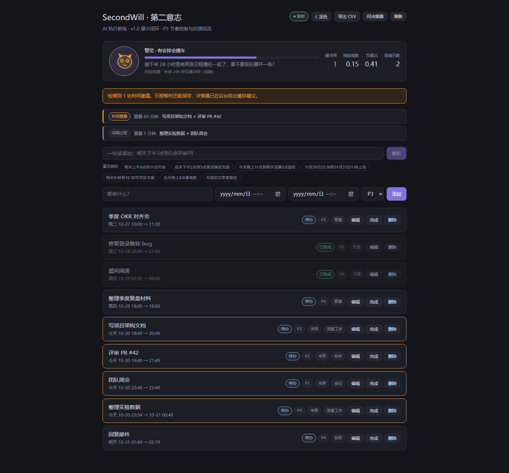
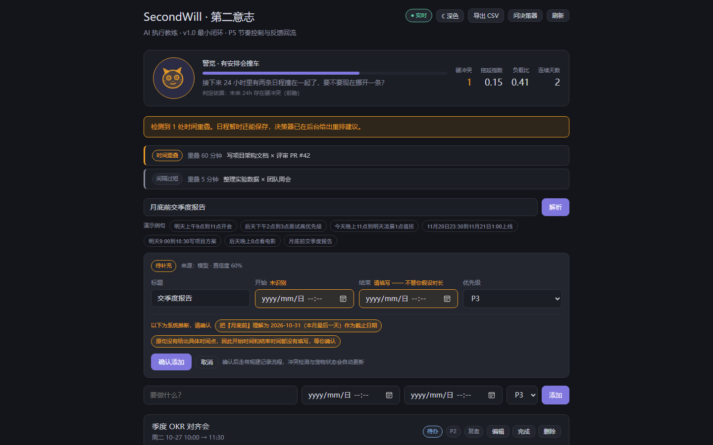
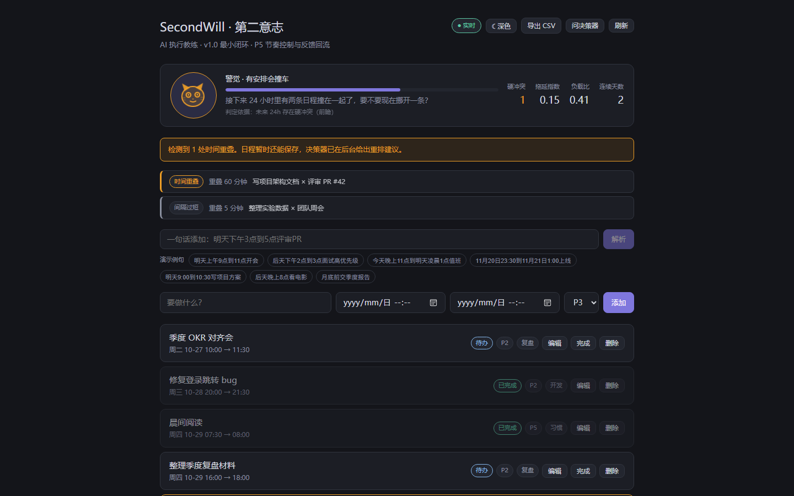
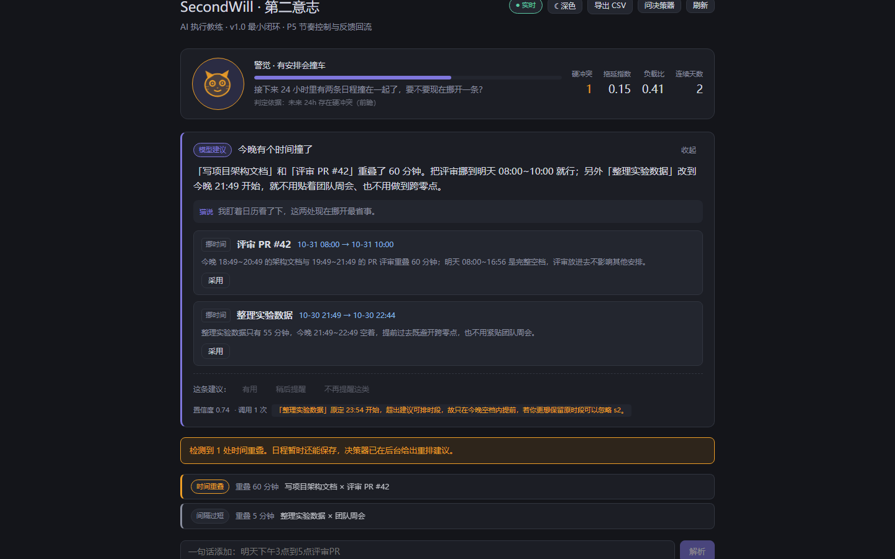
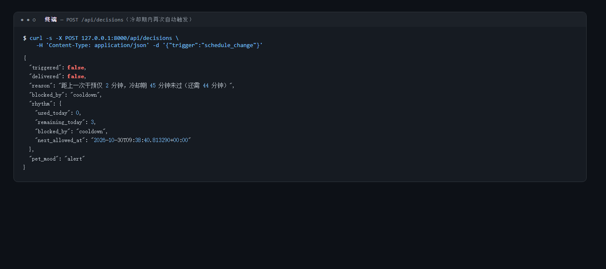
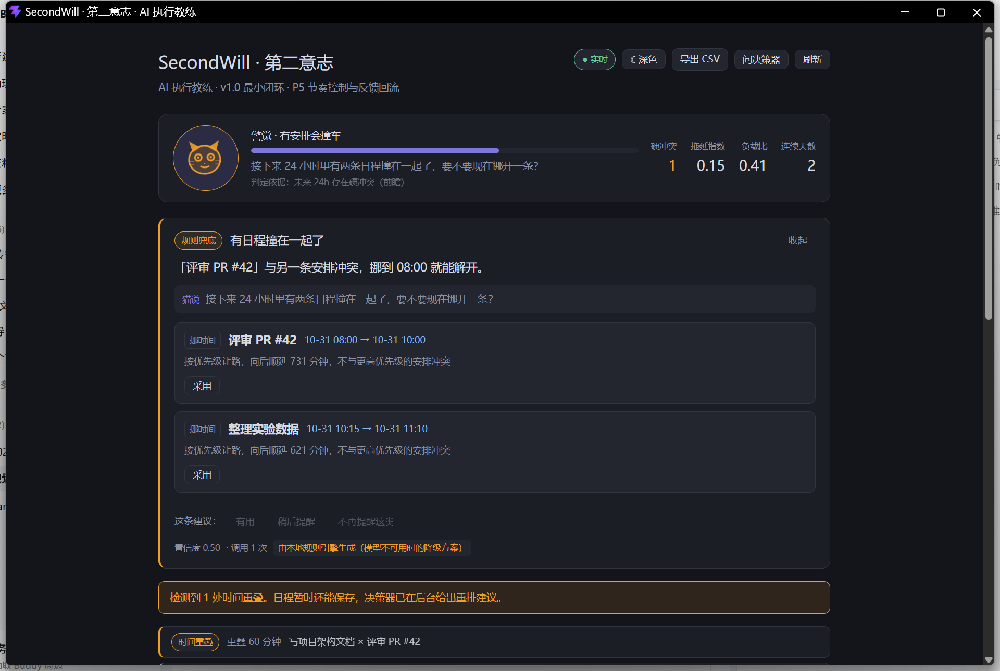

# SecondWill · 第二意志 · AI 执行教练 —— 作品介绍

> 本文档按「作品介绍」的七项要求组织：项目详情与使用方式、项目亮点、AI 相关测试与验证的落地情况、关键技术、项目图片、发表与获奖情况、基于既有项目的优化说明。
> 文中所有数字均取自本仓库的 README、`docs/01-架构设计.md` 与各期验收记录，可直接核对。

---

## 基本信息

| 项 | 内容 |
|---|---|
| 作品名称 | SecondWill · 第二意志 · AI 执行教练 |
| 作品定位 | **拖延干预系统 / AI 执行教练**（不是待办清单） |
| 交付形态 | Web 全栈应用（本地运行），可一键以独立应用窗口或 PWA 呈现 |
| 后端 | FastAPI + Pydantic v2 + SQLAlchemy 2.0 + SQLite |
| 前端 | React + TypeScript + Vite（SVG + CSS 动画宠物） |
| 大模型 | DeepSeek（`deepseek-flash`，OpenAI SDK 兼容接口） |
| 实时通道 | SSE（Server-Sent Events） |
| 代码规模 | 后端 `app` + `tests` + `scripts` 约 12.7k 行 Python（80 个 `.py` 文件）；前端 `src` 约 2.7k 行 TS/TSX/CSS（18 个文件）；受版本管理文件 170 个 |
| 自动化测试 | 20 个测试文件、**273 项用例全部通过**（分期实测：P2 92 → P3 169 → P4 245 → P5 273） |
| 运行环境 | Python ≥ 3.11、Node ≥ 20.19（本机实测 Python 3.13.14 / Node v22.22.2） |
| 仓库地址 | https://github.com/xuan5579/SecondWill |
| 开发周期 | 2026-10-28 至 2026-10-30（P1–P5 五期，v1.0 最小闭环已完成） |

---

## 一、项目详情与使用方式

### 1.1 要解决什么问题

市面上绝大多数时间管理工具解决的是「**记下来**」：把待办写进去、打个勾、导出报表。它们默认用户缺的是记录工具。

但拖延者真正缺的不是记录，而是**执行**——日程写好了照样撞车，撞车了照样拖着不改，改不改也没人提醒，提醒多了又变成说教轰炸。SecondWill 要解决的是「记下来之后的事」：

> **分析执行数据 → 检测冲突 → 给出重排建议 → 主动干预 → 用宠物状态反馈执行力。**

大模型在其中的角色是**决策器**，不是聊天窗口。它不陪你聊天，它只回答一个问题：**「此时此刻，该不该打扰这个用户、用哪种方式打扰、说什么。」**

### 1.2 核心闭环

```
改日程 → 冲突检测 → 信号聚合 → 宠物状态（同步快路径，毫秒级）
                            ↓
                       节奏闸门 → LLM 决策（可降级）→ 干预卡片 → 用户反馈
                            ↑                                        │
                            └────────── 反馈回流进 prompt ────────────┘
```

一条完整的因果链：用户动一下日程，系统在毫秒级内更新宠物这个「执行力仪表盘」，随后异步问模型要一个决策，决策要先过节奏闸门（不是想说就说），送达后用户的接受 / 稍后 / 别再提会回流进下一次的提示词——系统会真的「学会」你讨厌被催。

### 1.3 功能清单

| 能力 | 说明 |
|---|---|
| 日程记录 CRUD | 统一数据模型 `record`（v1.0 仅 `type=schedule`），含优先级 1–5、状态枚举、标签 |
| 自然语言录入 | 一句话生成日程：**先规则、规则不行才调 LLM**；解析结果出「草稿卡片」，用户确认才入库 |
| 冲突检测 | 三类：`overlap`（硬冲突·物理重叠）/ `no_buffer`（软冲突·缓冲不足）/ `overload`（负载过高） |
| 信号诊断 | 拖延指数、负载比、空白时段、7 日完成率、逾期数、连续达标天数 |
| 宠物状态机 | 六档 `alert / dormant / tired / guilty / great / normal`，按优先级短路判定，同一输入永远同一输出 |
| LLM 决策 | 三类决策：`reschedule`（重排）/ `nudge`（轻推）/ `no_action`（**允许模型拒绝干预**） |
| 干预卡片 | 含建议明细、风险等级、宠物台词、来源角标（`llm` / `cache` / `fallback`） |
| 干预节奏闸门 | 冷却期 45 分钟、每日上限 3 条（按本地日重置）、同类被忽略 3 次自动降权 |
| 反馈回流 | 接受 / 稍后 / 屏蔽写入行为事件流，并**渲染进下一次的提示词** |
| 实时推送 | SSE 推送 `pet_state` / `conflict` / `intervention` / `decision`；断连自动退化为 30 秒轮询 |
| 行为事件流 | `task_started / task_delayed / task_abandoned / task_completed / intervention_accepted / intervention_ignored` |
| CSV 导出 | 12 列（`utf-8-sig`，Excel 中文不乱码），沿用旧版字段并补 `status` / `is_overdue` |
| 旧版数据迁移 | `scripts/import_legacy.py`，20/20 条真实旧数据导入通过 |
| 桌面化呈现 | 独立应用窗口（浏览器 `--app=` 模式）/ PWA 安装 / 可选 pywebview 原生窗口 |
| 深色模式 | 沿用旧版深色配色，保持产品辨识度 |

### 1.4 使用方式

**① 环境要求**：Python ≥ 3.11、Node ≥ 20.19。

**② 安装依赖**

```bash
cd backend  && pip install -e ".[dev]"
cd frontend && npm install
cp .env.example .env          # Windows: copy .env.example .env
```

**③ 启动（二选一）**

- **Windows 一键（推荐）**：双击项目根目录的 `start-dev.bat`（要无地址栏的独立窗口则双击 `start.bat`），脚本会自动起服务、开浏览器、结束时停住窗口显示退出码。
- **命令行**：`python scripts/dev.py`（后端 + 前端一起起，Ctrl+C 一起停）或手动两条：

```bash
uvicorn app.main:app --reload --host 127.0.0.1 --port 8000   # 后端
npm run dev -- --host 127.0.0.1 --port 5173                  # 前端
```

打开 http://127.0.0.1:5173（API 文档在 http://127.0.0.1:8000/docs）。
> 注意：必须统一用 `127.0.0.1`，不要用 `localhost`——本机 localhost 优先解析到 IPv6，而后端只绑 IPv4，且 CORS 按 Origin 逐字节匹配，两者混用会导致「页面能打开但数据永远为空」。

**④ 三种运行档位（关键：不配 API Key 也能跑完整闭环）**

| 档位 | 条件 | 表现 |
|---|---|---|
| 真实模型 | `.env` 填 `DEEPSEEK_API_KEY` | 决策 `source=llm` |
| 规则降级 | **不填 Key**（默认） | 决策 `source=fallback`，冲突检测、宠物情绪、节奏闸门、反馈回流全部照常 |
| 离线演示 | `DEMO_MODE=true` | 走预录制 fixture 回放，`source=cache`、`attempts=0`，**零网络请求，断网也能答辩** |

（改完 `.env` 必须重启后端——`load_dotenv` 只在导入时执行一次。）

**⑤ 30 秒演示脚本（全程无需 API Key）**

```bash
python scripts/seed.py                      # 造演示数据（刻意含 1 处重叠 + 1 处零缓冲）
curl -s 127.0.0.1:8000/api/state | python -m json.tool
# → pet.mood == "alert"，signals.conflicts 含 1 条 overlap(hard) + 1 条 no_buffer(soft)

curl -s -X POST 127.0.0.1:8000/api/decisions -H 'Content-Type: application/json' -d '{"trigger":"manual"}'
# → source=fallback、decision_type=reschedule、1 条 move 建议、宠物台词
# → 立刻再触发一次自动决策：triggered=false、blocked_by="cooldown"（冷却期生效）

curl -s -X POST 127.0.0.1:8000/api/parse -H 'Content-Type: application/json' \
  -d '{"text":"今天下午4点到6点产品评审会"}'       # 自然语言 → 草稿卡片（只读，不写库）
```

**⑥ 其它常用命令**

```bash
cd backend && pytest -q                                   # 273 项测试
python scripts/import_legacy.py --input 旧数据.json --report   # 导入旧版 JSON（预演）
python scripts/record_demo.py --clean --decisions --nl-llm     # 录制真实模型响应供日后回放
python scripts/probe_llm.py                               # 探测模型能力边界
```

### 1.5 项目结构与文档索引

```
backend/app/    FastAPI 应用：api / services（确定性内核）/ llm（编排·校验·降级）/ models / schemas
backend/tests/  20 个测试文件，273 项用例
frontend/src/   React + TS：components（schedule / pet / intervention）、hooks、lib、types（由 OpenAPI 生成）
scripts/        dev.py（一键启动）、seed.py、import_legacy.py、record_demo.py、probe_llm.py
docs/           01 架构设计 · 09 实现决策日志 · 10 旧功能对照表 · 11 自然语言录入 · 12 LLM 决策与降级 · 13 干预节奏与反馈回流 · 14 本篇
```

---

## 二、项目亮点

### 2.1 架构骨架换了：从「CRUD」变成「控制闭环」

原桌面应用的骨架是「用户输入 → 存储 → 展示」，新系统的骨架是：

```
行为采集 → 信号诊断 → LLM 决策 → 主动干预 → 反馈回流
   ▲                                            │
   └────────────────────────────────────────────┘
```

这个替换带来三个结构性后果，也正是本项目全部新增模块的由来：**需要行为事件流**（模型的输入不是日程表，而是执行痕迹）、**需要服务端主动推送**（干预是系统发起的，不是用户请求的）、**需要反馈回路**（否则系统永远学不会「这个人讨厌催」）。

### 2.2 「情绪是仪表盘，模型是大脑与台词」——AI 与确定性代码各司其职

这是一条主动的产品判断，不是「模型慢所以先渲染情绪」的性能妥协：

- **宠物情绪是确定性仪表盘**：由后端 `pet.compute()` 纯函数即时计算（目标 < 200ms），同一份数据永远指向同一个读数，**不经过、不等待模型**。仪表盘一旦会抖（刷新两次表情不一样），可信度就归零——而「一致性」恰好是概率模型的短板。
- **模型只贡献一个字段 `pet_line`**：判断「这只猫现在该是什么表情」用不上语言理解，那是阈值表的事；判断「该用什么语气劝这个人重新开工」才用得上模型。UI 上表现为「猫先变了表情，随后说了一句话」——这个先后关系是设计意图，不是降级表现。

**推论**：即使模型完全不可用，宠物情绪依然准确，只是台词退回模板库。系统最依赖外部服务的部分被隔离在了最小作用域里。

同类约束还有两条：**冲突检测不给 LLM**（区间重叠是算术，不是权衡）、**干预节奏不给 LLM**（模型天然倾向「多说点」，让它自己决定何时打扰，结果必然是每十分钟弹一次说教——这是拖延干预类产品最常见的死法）。

### 2.3 防过度干预：节奏闸门 + 反馈回流双通道降权

三参数全部集中在 `backend/app/core/constants.py`，业务代码零字面量：冷却期 45 分钟、每日上限 3 条（按本地日重置）、同类忽略 3 次降权。

两条刻意的取舍：

1. **手动触发绕过闸门**——用户主动问一次，不该被「额度用完」拒绝，但仍刷新冷却时钟；
2. **降权是双通道的**——被屏蔽的类型既进闸门黑名单，**也进 prompt 的负面清单**，让模型自己不再提，而不是每次辛苦生成一条注定被丢掉的建议。

### 2.4 降级不伪装，且离线可演示

决策结果带 `source` 三档溯源：`llm`（模型）/ `cache`（命中缓存或录制）/ `fallback`（规则兜底）。
**`fallback` 不会伪装成模型输出**——`caveats` 里明说自己是规则生成的，前端用橙色角标标注。

配合 `DEMO_MODE` 录制回放，答辩时断网也能跑完整闭环（`source=cache`、`attempts=0`、零网络请求）。这不是临时补丁，而是与 L0–L4 降级同一套哲学的常规能力。

### 2.5 自然语言录入：规则优先 + LLM 兜底，且「解析 ≠ 入库」

- 本地正则规则优先，规则无法确定时才调 LLM；输出严格 schema，解析不出返回明确 `error` + 修复建议，**禁止静默填默认值**；
- 结果先渲染为**草稿卡片**：缺失字段 `missing` 留空让用户填，推断字段 `assumptions` 预填但标黄让用户改，点确认才入库，且复用既有 `POST /api/records` 链路；
- `NEED_LLM` 是解析器**内部**的分派信号，不进对外契约。因此 P3（纯规则）与 P4（接 LLM）两期对外 schema 完全一致，**接模型时前端草稿卡片未改一行代码**。LLM 是增强，不是前置依赖。

### 2.6 反负罪感的产品价值观

旧版宠物的心情会随时间自然衰减、离线还会追补扣点——对拖延者而言那是**惩罚机制**。新版 `energy` 是即时重算：三天不打开再回来，看到的是真实状态，**不会因为离开而变差**。一个会因为你没打开而抑郁的宠物，本质是负罪感制造机，与「反拖延」的目标相悖。同理，成就系统、连续签到等带惩罚性断签的养成机制被有意移出 v1.0。

### 2.7 值得单独讲的三处工程细节

1. **修掉了旧版的静默漏检**：旧版把时间存成「当日分钟数」，`23:30→次日01:00` 会被算成长度 0 且**完全检测不到冲突**。新版改用绝对 datetime 区间，并在测试里把该用例钉死。
2. **缓存指纹相对化**：请求里的绝对时间先换成「距基准时刻的分钟数」再取哈希，否则今天录的演示 fixture 隔天全部落空。
3. **桌面化不引入 Electron / Tauri**：浏览器是运行载体，窗口只是可选呈现（浏览器 `--app=` 模式 / PWA / 可选 pywebview）。引入桌面壳会破坏「clone 下来就能跑」的复现性，也会往提交历史里塞工具链产物。**没有为任何一个「窗口」写过一行前端分支代码。**

---

## 三、AI 相关测试与验证的落地情况

本项目把大模型当作**不可靠的外部依赖**来对待，所有 AI 能力都配了对应的验证手段，分四层落地。

### 3.1 分层测试策略

| 层 | 对象 | 手段 | 规模 |
|---|---|---|---|
| **纯函数层** | `conflict` / `signal` / `pet` / `rhythm` | 不启动 Web、不碰数据库、不访问网络；`now` 由调用方注入，可完整单测 | 冲突检测单一文件 29 项，含四类对抗性用例 |
| **契约校验层** | `validator` 10 条规则 | 对抗性样例：伪造 `record_id`、越界时间、移动不可变记录、引入新硬冲突 | `test_validator.py` 28 项 |
| **归一化层** | `normalize` 同义词兜底 | 枚举跑偏的对抗样例（`dismiss → snooze` 而非 `mute`，后者永久降权不可逆） | `test_normalize.py` + `test_normalize_adversarial.py` |
| **端到端层** | 决策链路 / 干预反馈 | `test_decision_api.py`、`test_feedback_loop.py`、`test_pipeline.py` 等 | 总计 273 项全部通过 |

**`no_llm` fixture 是一项关键设计**：它把「发生了一次 LLM 调用」变成**断言失败**。确定性内核的 8 项端到端用例在该 fixture 下全部通过，等于用测试证明了「不依赖模型，系统也能看懂用户状态」。

### 3.2 防模型跑偏：收窄 + 显式允许值 + 归一化兜底

- **契约收窄**：v1.0 枚举只保留会真实产生的值。DeepSeek 不强制 schema，**枚举越少，模型跑偏的概率越低**，校验器的拒绝面也越小；
- **prompt 显式列出允许值 + 易错对照**（主力防线）；
- **`normalize.py` 同义词归一化**（兜底，留原始值日志）。实测结论：**兜底一次都没被触发**——主力把问题拦在了前面，兜底层的价值在于「用不上」。

### 3.3 能力探测：不猜，去实测

`scripts/probe_llm.py` 对四种组合做真实探测（2026-10-29）：

| 组合 | HTTP | 结论 |
|---|---|---|
| A · `json_object` 单独 | 200 | ✅ 合法 JSON，字段齐全 |
| B · `json_object` + `thinking` | 200 | ✅ 可同用（但默认已带推理，故代码不显式传，少一个失败面） |
| C · provider 侧 `json_schema` | **400** | ❌ `This response_format type is unavailable now` |
| D · 无 `response_format`（基线） | 200 | ✅ 合法 JSON，但推理 token 近乎翻倍 |

结论直接写进设计：**provider 侧 schema 强制不可用 → 后端校验层是强制路径而非锦上添花**。

### 3.4 成功率量化：从「能打通」到「第一次就答对」

同一份重 prompt 连续跑 6 次 `complete_json` + 校验，改动前后各一轮：

| 结果 | 改动前（2048 tokens / 旧 prompt） | 改动后（4096 tokens / 新 prompt / 有归一化） |
|---|---|---|
| 一次通过校验 | **0 / 6** | **6 / 6** |
| 截断 `truncated` | 2 | 0 |
| 空响应 `empty` | 1 | 0 |
| 枚举跑偏（L1 失败） | 3 | 0 |

完整编排器 5 次：`source=llm` 由 3/5（attempts 2/2/3）变为 **5/5（attempts 全为 1）**，`fallback` 由 2 次降到 0。

**排查出的真实成因值得单独记一笔**：所谓「偶发空 content」其实是 `max_tokens` 不够——**推理 token 把额度吃光了，`finish_reason` 就是 `length`**。最初提的「空 content 重试一次」因此作废，改为把 `EMPTY` 并入 `TRUNCATED` 走同一条抬档重试路径（`LLM_TOKEN_LADDER = (4096, 8192)`）。

### 3.5 录制回放：把真实响应变成回归基线

`DEMO_RECORD=true` 录下真实响应，`DEMO_MODE=true` 回放。它同时是**答辩保底**和**回归基线**：三场景（硬冲突 / 拖延 / 过载）与自然语言清单外句子均已落 fixture，`test_demo_cache.py`、`test_demo_fallback.py`、`test_parse_api.py` 保证回放链路与「相对日期常青性」不被改坏。

### 3.6 提示词工程的量化闭环

实测发现推理 token 随记录条数与内容歧义度增长（9 条高歧义记录已达 2737）。已实施第一刀：`LLM_PROMPT_MAX_RECORDS` 40 → **14**，且截断前按相关度排序（硬冲突对 → 软冲突 → 逾期 → 未来 24h → 远期 → 已完成）。实测修正了预期：撞顶的主导因素是**内容歧义度**而非条数，裁剪的价值是给「条数 × 歧义度」的最坏情况封顶。`test_prompt_trimming.py` 锁定该行为。

---

## 四、关键技术

### 4.1 技术选型

| 层 | 选型 | 理由 |
|---|---|---|
| 后端框架 | FastAPI + Pydantic v2 | ASGI 原生支持并发与流式；Pydantic 一处定义同时服务 API 校验、LLM 契约、prompt 示例 |
| 数据层 | SQLAlchemy 2.0 + SQLite | 单用户本地文件，零运维；事务原子性强于手写临时文件 |
| 实时推送 | **SSE（非 WebSocket）** | 干预是单向推送，SSE 自带断线重连，实现成本约为 WebSocket 的一半 |
| 前端 | React + TypeScript + Vite | 不选 Next.js：后端已独立，SSR / API Routes 会模糊要展示的前后端职责边界 |
| 状态管理 | TanStack Query + Zustand | 服务端状态与 UI 状态分离 |
| 宠物呈现 | SVG + CSS 动画 | 无素材依赖、任意缩放、便于按六档调色；不往仓库塞二进制 |
| 大模型 | DeepSeek（`deepseek-flash`，OpenAI SDK 兼容） | `json_object` 模式；`deepseek-chat` 已退役 |
| 类型同步 | 前端 `types/` 由后端 OpenAPI 生成 | 避免手写类型漂移 |
| 测试 | pytest | 273 项，含对抗性样例与纯函数性质验证 |

### 4.2 关键设计与实现

**① 契约单一真源。** `llm/contract.py` 的 Pydantic 模型同时用于：后端权威校验、生成 JSON Schema、渲染进 prompt 的格式示例。三者不会漂移。`llm/provider.py` 是**唯一**发起外部模型调用的地方，换模型只改这一处。

**② 纯函数服务层 + 单一 IO 边界。** `conflict` / `signal` / `pet` / `rhythm` 全部是纯函数（`now` 由调用方注入），可脱离 Web 单测；读写数据库集中在一个边界（`services/state.py`、`services/decision_flow.py`）。

**③ 时间语义统一。** 存储一律 UTC naive，**只在 API 层转本地**（单一转换点，到处转迟早错位一个时区）。契约里为此拆出 `UtcDT` / `IsoDT` 两个类型——共用一个会让建议整体平移一个时区。

**④ 降级分级 L0–L4。** L0 模型不可用→规则降级引擎（按优先级贪心顺延）+ 模板台词；L1 schema 失败→重试 2 次并回传 Pydantic 错误原文；L2 业务校验失败→丢弃违规建议、保留可行部分；L3 模型说「不用干预」但信号很强→后端发轻量规则干预（**仍受节奏闸门约束**）；L4 SSE 断连→退化 30 秒轮询。

**⑤ 节奏闸门是纯函数 + 两道检查点。** 调用模型**之前**查冷却与额度（省调用），决策产出**之后**查降权（只有拿到 `decision_type` 才知道该不该发）。

**⑥ 阈值零字面量。** 全部可调参数集中在 `core/constants.py`（冲突阈值、宠物六档、NL 解析、节奏三参数、LLM token 阶梯），业务代码里不出现魔法数字。

**⑦ 桌面化不改架构。** 浏览器 `--app=` 模式 / PWA（`manifest.json` + 纯文本 SVG 图标）/ 可选 pywebview，三种方式都不引入 Tauri/Electron，页面、接口、SSE、宠物状态机全部照旧。

---

## 五、项目相关图片

> 以下截图均为 2026-10-30 在真实运行的系统上实拍（后端 FastAPI + 前端 Vite + Edge 浏览器，演示数据由 `python scripts/seed.py` 生成），未做任何后期处理。



**图 1 · 主界面全貌**（整页）：顶部标题「SecondWill · 第二意志」、宠物面板（**警觉 · alert**，含硬冲突数 / 拖延指数 / 负载比 / 连续天数）、冲突预警横幅、自然语言输入区与演示例句、快捷表单、日程列表（冲突日程以高亮边框标出）。



**图 2 · 自然语言录入与草稿卡片**：输入「月底前交季度报告」→ 解析出草稿卡片：**待补充**徽章、来源「模型 · 置信度 60%」、开始/结束时间因原句未给出而**留空待填**（不替你假设时长）、下方黄色 chips 标出系统推断（把「月底前」理解为 2026-10-31），点「确认添加」才入库。



**图 3 · 冲突检测与宠物 ALERT 状态**：检测到「写项目架构文档」与「评审 PR #42」重叠 60 分钟（时间重叠）+「整理实验数据」与「团队周会」间隔仅 5 分钟（间隔过短），宠物同步切到 **alert**（前瞻状态：未来 24h 有硬冲突）。



**图 4 · 干预卡片与来源角标**：手动点「问决策器」后模型给出的重排建议——左上角蓝色「**模型建议**」角标（`source=llm`）、两条 move 建议明细（含原时间 → 建议时间、风险理由、**采用**按钮）、「猫说」台词、底部反馈按钮（有用 / 稍后提醒 / 不再提醒这类）与「置信度 0.74 · 调用 1 次」。



**图 5 · 节奏闸门拦截**（API 实测响应）：冷却期内再次以自动触发（`trigger=schedule_change`）请求决策，返回 `triggered=false`、`blocked_by=cooldown`、reason「距上一次干预仅 2 分钟，冷却期 45 分钟未过（还需 44 分钟）」——防打扰是后端硬约束，模型无权绕过。



**图 6 · 独立应用窗口**（Edge `--app=` 模式，无地址栏，标题栏即应用名「SecondWill · 第二意志 · AI 执行教练」）：同时演示了**降级不伪装**——卡片左上角为橙色「规则兜底」角标（`source=fallback`），并明确注明「由本地规则引擎生成（模型不可用时的降级方案）」，绝不伪装成模型输出。

*（可选补充：图 7 双标签页 SSE 同步演示、图 8 CSV 导出结果、图 9 `pytest -q` 273 passed 终端输出。）*

---

## 六、发表与获奖情况

**本项目此前未公开发表、未申报或获得过任何奖项，本次为首次提交。**

补充说明：

- 作品为**个人独立开发**的原创项目，全部代码、文档与设计决策记录均由本人完成，无第三方代码抄袭；
- 仓库 https://github.com/xuan5579/SecondWill 为公开仓库，提交历史可完整追溯（含各期里程碑的验收记录与实现决策日志）；
- 项目中使用的第三方依赖均为开源库（FastAPI、React、SQLAlchemy 等），模型服务为 DeepSeek 官方 API；
- 若后续有发表、展出或获奖情况，请直接修改本节。

---

## 七、基于既有项目的优化说明

### 7.1 上游项目

本项目是在一个**本人此前开发的 Python 3.12 + Tkinter 桌面应用**基础上重制而成：

| 项 | 旧版 | 新版 |
|---|---|---|
| 形态 | Tkinter 桌面单文件（`game.py` 5651 行 + `demo/demo_data.py` 410 行） | Web 全栈（前后端分离） |
| 存储 | `plans.json` / `pet.json` / `pet_diary.json` / `achievements.json` / `config.json` | SQLite + SQLAlchemy 2.0 |
| 宠物 | 养成游戏：经验 / 等级 / 心情 / 亲密度 / 小鱼干 / 形态 / 关系阶段，七维耦合 | 执行力仪表盘：一个六档情绪 + 一个 `energy` 标量 |
| 智能 | 无 AI，全部模板拼句与规则提醒 | LLM 决策器 + 规则降级 + 反馈回流 |
| 代码规模 | 5651 行单文件 | 后端约 12.7k 行 Python（80 个文件）+ 前端约 2.7k 行 TS/TSX/CSS |

**上游项目未被修改**，仅作只读审阅；迁移对照见 `docs/10-旧功能对照表.md`（✅ 已迁移 20 项 / 有意移出 21 项）。

### 7.2 最根本的优化：定位反转

旧版是「**宠物养成游戏，附带一个日程表**」——5651 行里约六成服务于经验/等级/小鱼干/亲密度/形态/成就这套养成闭环。

新版是「**AI 执行教练，宠物是执行力仪表盘**」。

**这两个产品的重心是相反的。** 所以迁移不是「功能平移」，而是把宠物从「需要喂养的虚拟生命」降维成「读者一眼能读懂的执行状态可视化」。这不是偷工减料，是定位决定的：宠物养成解决的是「让你想打开这个软件」，而拖延者的问题从来不是不想打开。

### 7.3 架构层面的优化

| 维度 | 旧版 | 新版优化 |
|---|---|---|
| 骨架 | 输入 → 存储 → 展示（CRUD） | 行为采集 → 信号诊断 → LLM 决策 → 主动干预 → 反馈回流（**控制闭环**） |
| 执行痕迹 | ❌ 无 | ✅ 新增行为事件流（开始 / 推迟 / 放弃 / 完成 / 采纳干预 / 忽略干预），这是模型真正的输入 |
| 推送 | ❌ 无（只能等用户打开） | ✅ SSE 服务端主动推送，前端断连自动降级轮询 |
| 反馈 | ❌ 无（提醒完就结束） | ✅ 反馈回流进事件流，并**渲染进下一次 prompt**（双通道降权） |
| 干预内容 | 模板拼句，一轮只一句 | ✅ LLM 生成，但节奏控制仍是后端硬约束 |
| 模型可靠性 | — | ✅ 10 条输出校验 + L0–L4 降级 + 缓存 + 录制回放 |
| 可测试性 | ❌ 逻辑与 UI 耦合在单文件里 | ✅ 服务层纯函数化，273 项自动化测试 |

### 7.4 修复的旧版缺陷（本次审阅发现）

1. **跨零点区间静默漏检（最重要）**：旧版时间存成「当日分钟数」，`23:30→次日01:00` 的 `end_minutes(60) < start_minutes(1410)`，`duration()` 得 `max(0, 60-1410)=0`，冲突判定 `1410 < 60` 为假 → **完全检测不到冲突**。新版改用绝对 datetime 区间（`end <= start` 时 +1 天），并加入对抗性用例钉死。
2. **自然语言解析的 5 处硬编**：没写日期默认今天、只写一个时间点默认 60 分钟、跨天结束时间**静默截断到 23:59**、"3点开会"按凌晨解析、重复语义只加一句小字 note。新版一律改为 `missing`（留空待填）或 `assumptions`（预填标黄待改），**不再替用户做决定**。
3. **前瞻信号与回顾信号混用**：旧版 `alert` 与 `tired` 同源混判，用户无法从宠物表情反推「该担心未来还是弥补过去」。新版两者严格分离（`alert`=未来 24h 有冲突，`tired`=已连续拖延），并按优先级 `alert > dormant > tired > guilty > great > normal` 短路。
4. **软冲突概念缺失**：旧版只有「重叠 / 不重叠」二值。新版新增 `no_buffer`（缓冲不足）与 `overload`（负载过高），软冲突可由模型权衡是否值得重排。

### 7.5 新增能力（旧版完全没有）

拖延指数量化（`逾期数 × 平均逾期天数 ÷ 近 7 天应完成总数`，归一化 0–1，纯函数可单测）· 负载比与空白时段识别 · LLM 决策三类（含 `no_action` 出口）· 干预卡片与来源角标 · 节奏闸门三参数 · 反馈画像与 prompt 负面清单 · 自然语言录入的 LLM 兜底分支 · DEMO 录制回放 · 缓存指纹（相对化）· SSE 实时通道 · PWA / 独立应用窗口 · CSV 增 `status` / `is_overdue` 两列。

### 7.6 有意移出的功能与理由（评委问「为什么不保留」时的答案）

| 移出项 | 理由 |
|---|---|
| 经验 / 等级 | 等级是「养成」叙事的核心，却是「教练」叙事的噪音 |
| 心情随时间衰减 + 离线追补扣点 | **惩罚机制**：会因为你不打开程序而变差，与反拖延目标相悖 |
| 小鱼干经济闭环 / 抚摸互动 | 完整小游戏，会稀释「AI 决策器」这个主题；与执行力无反馈关系 |
| 亲密度 / 形态养成 | 反映「你在做什么类型的事」，不是「你执行得好不好」，与仪表盘职责冲突 |
| 成就系统 8 枚徽章 | 成就天然带负罪感风险（「一周坚持」断签即惩罚用户） |
| 取消完成扣回奖励 | 防刷奖是宠物经济的需求；新版无奖励可刷 |
| 宠物日记（模板拼句） | v1.1 由 LLM 重做价值极高——模板拼句的信息量远低于模型归因 |
| 卡片分页 / 悬停动画等 Tk 特有问题 | 属于技术栈红利或 Tk 专属问题，Web 端无需迁移 |

### 7.7 数据迁移与兼容

`scripts/import_legacy.py` 已按真实样例校准（`plans.json` 20 条 / 13 字段），**20/20 条全部导入通过**：

- 优先级「高/中/低/空」→ int 1–5（3=中性，空值与「中」同源，避免凭空抬高未标级任务）；
- 8 位短 id → `rec_` 前缀新 ID（代价：重复导入会产生重复数据，迁移是一次性操作，接受此代价）；
- 旧版有但新版无对应字段的键（`exp_awarded` / `fish_awarded` / `postpone_count` / `original_date` / `id`）明确标为「有意不导入」；
- 脏数据容错解析（每字段 try/except 回退）由 `build_span()` 继承，沿用旧版的健壮性设计。

---

## 附录：一句话概括

> SecondWill 不是一个更好看的待办清单，而是一个**会看数据、会挑时机、会认错、也懂得闭嘴**的执行教练：确定性代码负责「你现在的真实状态是什么」，大模型只负责「该不该说、说什么」，而「什么时候能说」由一套防打扰的硬闸门把关——即使模型下线，这只猫的表情依然是准的。
